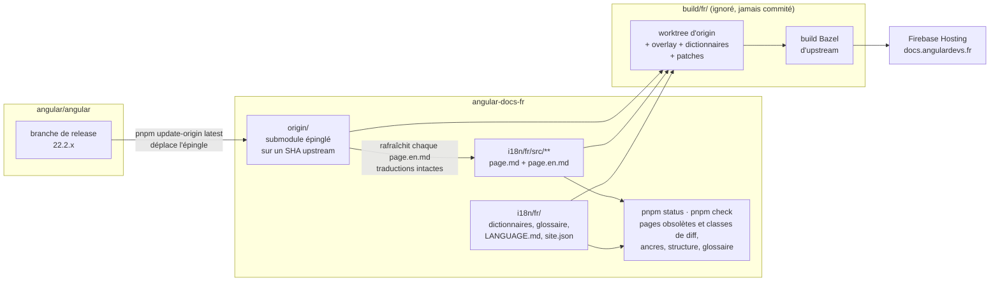

# angular-docs-fr

Traduction française communautaire de [angular.dev](https://angular.dev), la documentation officielle d'Angular, publiée sur **[docs.angulardevs.fr](https://docs.angulardevs.fr)** et maintenue par [Angular Devs France](https://github.com/angular-devs-france).

Ce dépôt n'est pas un fork d'`angular/angular` : il contient uniquement les pages traduites et de quoi reconstruire le site. L'anglais reste la référence ; la traduction suit la dernière branche de release d'Angular (aujourd'hui `22.2.x`) et chaque page sait de quelle version de l'anglais elle a été traduite. Une page en retard affiche un bandeau et un lien vers l'original.

Le dépôt a été créé à partir du template [angular-docs-rosetta](https://github.com/openng-org/angular-docs-rosetta), dont il reçoit les mises à jour d'outillage par PR automatique. Le modèle est celui éprouvé par [angular.jp](https://github.com/angular/angular-ja) et [angular.lat](https://github.com/angular-hispano/angular-docs-es).

## Contribuer à la traduction

Aucun build Angular n'est nécessaire pour traduire : Git, Node 26 (`nvm use` lit `.nvmrc`) et pnpm suffisent.

```bash
git clone https://github.com/angular-devs-france/angular-docs-fr.git
cd angular-docs-fr
nvm use
pnpm install
pnpm bootstrap        # récupère (en shallow) le commit d'angular/angular épinglé dans origin/

pnpm status fr        # la file d'attente : pages obsolètes (avec classe de diff), non traduites, nouvelles, supprimées
```

Avant d'écrire une ligne, lisez [`i18n/fr/LANGUAGE.md`](i18n/fr/LANGUAGE.md) (vouvoiement, typographie, ce qui reste en anglais) et [`i18n/fr/glossary.json`](i18n/fr/glossary.json) (terminologie) : la relecture les applique.

Traduire une page :

```bash
pnpm status fr --init content/guide/signals/overview.md   # nouvelle page : crée le snapshot .en.md et la copie à traduire
pnpm status fr --diff content/guide/signals/overview.md   # page obsolète : le diff anglais depuis la traduction
# ... traduire, puis :
pnpm status fr --mark content/guide/signals/overview.md   # page obsolète : met à jour le marqueur
pnpm check fr i18n/fr/src/content/guide/signals/overview.md
```

Règles vérifiées par `pnpm check` : même nombre de lignes que le snapshot anglais (le marqueur excepté), mêmes titres avec leur ancre anglaise `{#comme-ceci}`, mêmes blocs de code, `docs-*` et liens, code/identifiants/URL intacts, glossaire respecté, espaces insécables avant `: ; ? !`.

Ensuite : une PR par page (ou petit groupe de pages liées), à partir du template de PR. Le détail est dans [CONTRIBUTING.md](CONTRIBUTING.md) et [docs/translating.md](docs/translating.md) ; les règles de la langue dans [i18n/fr/README.md](i18n/fr/README.md). Un Codespace fonctionne sans configuration (`.devcontainer/`).

Pour signaler une erreur sur le site sans toucher au dépôt : [ouvrir une issue](https://github.com/angular-devs-france/angular-docs-fr/issues/new?template=translation-error.yml) (le lien « Signaler un problème de traduction » des pages y mène aussi).

### Avec un assistant IA

Les skills sous `.agents/skills/` décrivent comment traduire une page ou un hunk (`adev-translation`) et comment maintenir le dépôt (`adev-i18n-maintenance`) ; elles commencent par lire `LANGUAGE.md` et le glossaire. Pointez votre assistant (Claude Code, Gemini CLI, Codex…) vers [`AGENTS.md`](AGENTS.md). Vous restez responsable du texte que vous soumettez.

## Comment ça marche

- `origin/` est `angular/angular` en submodule git, épinglé sur la tête de la dernière branche de release. Jamais modifié.
- `i18n/fr/src/**` reflète `adev/src/**`. Une page traduite `page.md` est accompagnée de `page.en.md`, l'anglais dont elle a été traduite, et commence par `<!-- source: <hash> -->`, le hash de ce snapshot. L'outillage sait donc exactement quelles pages sont en retard et montre le diff anglais.
- Les chaînes de l'interface (navigation, pied de page, home, `index.html`) sont des dictionnaires dans `i18n/fr/dictionaries/`, pas du Markdown.
- Le site est construit dans un répertoire jetable (`build/fr/`, jamais commité) : copie d'upstream, overlay des traductions, application des dictionnaires et de deux petits patches (sélecteur de langue, bandeaux), puis le build Bazel d'upstream lui-même, et déploiement sur Firebase Hosting.



## Suivre Angular (mainteneurs)

```bash
pnpm update-origin latest   # déplace l'épingle sur la tête de la dernière branche de release, rafraîchit chaque *.en.*
pnpm status fr --md         # la file : pages obsolètes avec classe de diff (a code/URL, b ≤ 5 lignes, c ≤ 30, d restructuration)
git switch -c sync/$(git -C origin rev-parse --short HEAD)
git add origin i18n && git commit -m "sync: update origin to $(git -C origin rev-parse --short HEAD)"
pnpm status fr --apply-mechanical all   # classe a : rien à traduire
# traduire les classes b/c/d (à la main ou avec la skill adev-translation), puis :
pnpm check fr
```

Un workflow planifié ouvre cette PR de sync chaque semaine ([sync-upstream.yml](.github/workflows/sync-upstream.yml)) ; un autre propose les mises à jour du template ([template-sync.yml](.github/workflows/template-sync.yml)). Chaque merge sur `main` reconstruit et déploie le site ([deploy.yml](.github/workflows/deploy.yml)) ; chaque push lance `pnpm check` ([ci.yml](.github/workflows/ci.yml)).

Build local (optionnel, pour voir le rendu ; ~200 Mo de téléchargement la première fois) :

```bash
pnpm start fr    # serveur de dev avec overlay à chaud
pnpm build fr    # build de production, mêmes cibles qu'angular.dev
```

Le guide complet (installation, déploiement, changement de branche de release, patches, dépannage) est dans [docs/guide.md](docs/guide.md) et [docs/maintenance.md](docs/maintenance.md).

## Organisation du dépôt

```
origin/                     submodule git : angular/angular au SHA épinglé (lecture seule)
i18n/fr/
  site.json                 domaine, dépôt, cibles Firebase, textes des bandeaux
  LANGUAGE.md               règles de la langue : front matter vérifié + prose pour humains et agents
  glossary.json             termes : à garder en anglais, traduction retenue, traductions interdites
  prh.yml, .textlintrc.json générés depuis glossary.json : règles textlint pour `pnpm check` et les éditeurs
  dictionaries/             navigation.json, ui.json, index-html.json, pipeline.json (anglais -> français)
  src/**                    overlay de adev/src/** : page.md + page.en.md, templates de l'app + .en.html
  README.md                 la communauté : mainteneurs, où discuter, règles de relecture
tools/                      la CLI `rosetta` (tools/cli.mjs) : update-origin, status, check, build, start…
tools/adev-patches/         010 sélecteur de langue, notice et bandeaux ; 020 analytics
.agents/skills/             adev-translation et adev-i18n-maintenance (format Agent Skills)
docs/                       guide, traduction, règles de langue, maintenance, recherche, architecture
build/fr/                   worktree d'origin + overlay (ignoré, jamais commité)
```

## Commandes

| Commande | Rôle |
| --- | --- |
| `pnpm bootstrap` | Initialise le submodule `origin` au SHA épinglé (shallow) et vérifie Node/pnpm |
| `pnpm status fr [--md\|--json]` | État par fichier : à jour, obsolète (classe a/b/c/d), non traduit, supprimé, snapshot périmé ; trous des dictionnaires. `--init`, `--diff`, `--mark`, `--apply-mechanical` agissent sur une page |
| `pnpm check fr [chemins…] [--strict]` | Snapshot et marqueur présents, parité des lignes et de la structure, ancres `{#english-anchor}`, mots-clés d'alerte, glossaire (textlint + prh), typographie |
| `pnpm update-origin <sha\|branche\|latest>` | Déplace l'épingle, rafraîchit chaque `*.en.*`, signale les fichiers upstream nouveaux, supprimés et renommés |
| `pnpm dictionaries fr [--prune]` | Ajoute les nouvelles chaînes upstream aux quatre dictionnaires ; `--prune` retire les clés obsolètes |
| `pnpm glossary fr [--check]` | Régénère les règles textlint depuis `glossary.json` |
| `pnpm start fr` / `pnpm build fr` | Serveur de dev / build de production |
| `pnpm report fr` | Statut JSON (couverture, fraîcheur) consommé par le site |
| `pnpm firebase-config` | Régénère `firebase.json` / `.firebaserc` depuis `i18n/fr/site.json` |
| `pnpm test` | Suite de tests de l'outillage |

`pnpm rosetta <commande> --help` liste les options de chaque commande.

## Statut

Couverture et fraîcheur de la traduction : https://docs.angulardevs.fr/assets/others/translation-status.json, ou `pnpm report fr`.

## Crédits et licence

Outillage : MIT, voir [LICENSE](LICENSE) ; il vient d'[angular-docs-rosetta](https://github.com/openng-org/angular-docs-rosetta), qui adapte des idées et du code d'[angular/angular-ja](https://github.com/angular/angular-ja) et d'[angular-hispano/angular-docs-es](https://github.com/angular-hispano/angular-docs-es). La documentation traduite est l'œuvre de l'équipe Angular chez Google et de ses contributeurs (MIT). Ce site est une traduction communautaire, non affiliée à Google ; il respecte les [règles d'usage de la marque Angular](https://angular.dev/press-kit).
