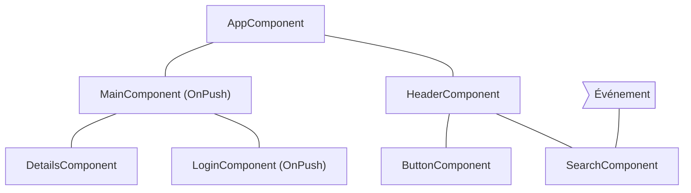
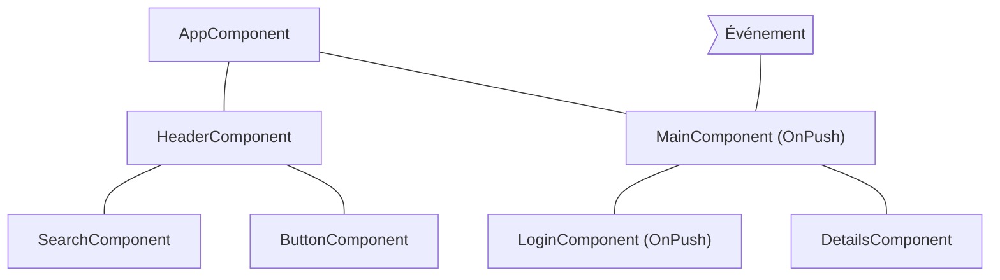
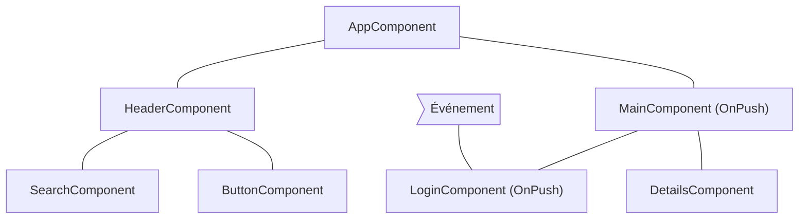
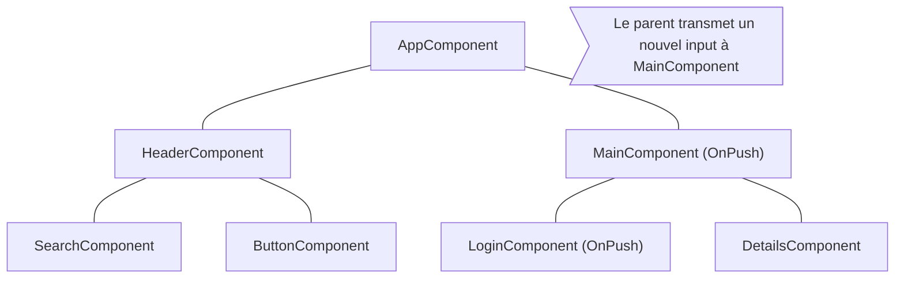

<!-- source: f5379f6af72fb6d11b3e786d771333d9ad1ba376 -->
# Ignorer des sous-arbres de composants

Par défaut, JavaScript utilise des structures de données mutables que vous pouvez référencer depuis plusieurs composants différents. Angular exécute la détection de changements sur l'ensemble de votre arbre de composants pour s'assurer que l'état le plus récent de vos structures de données est reflété dans le DOM.

La détection de changements est suffisamment rapide pour la plupart des applications. Cependant, lorsqu'une application possède un arbre de composants particulièrement grand, exécuter la détection de changements sur toute l'application peut provoquer des problèmes de performances. Vous pouvez y remédier en configurant la détection de changements pour qu'elle ne s'exécute que sur un sous-ensemble de l'arbre de composants.

## Utiliser `OnPush` {#using-onpush}

OnPush est la stratégie de détection de changements par défaut d'Angular (depuis la v22). Elle indique à Angular d'exécuter la détection de changements pour un sous-arbre de composants **uniquement** lorsque :

- Le composant racine du sous-arbre reçoit de nouveaux inputs à la suite d'un binding de template. Angular compare la valeur actuelle et la valeur précédente de l'input avec `Object.is`.
- Angular traite un événement _(par exemple via un event binding, un binding d'output ou `@HostListener` )_ dans le composant racine du sous-arbre ou dans l'un de ses enfants, qu'ils utilisent ou non la détection de changements OnPush.

## Scénarios courants de détection de changements {#common-change-detection-scenarios}

Cette section examine plusieurs scénarios courants de détection de changements pour illustrer le comportement d'Angular.

### Un événement est traité par un composant avec la détection de changements `Eager` {#an-event-is-handled-by-a-component-with-eager-change-detection}

Si Angular traite un événement dans un composant utilisant la stratégie `Eager`, le framework exécute la détection de changements sur l'ensemble de l'arbre de composants. Angular ignore les sous-arbres de composants descendants dont la racine utilise `OnPush` et qui n'ont pas reçu de nouveaux inputs.

Par exemple, si nous définissons la stratégie de détection de changements de `MainComponent` sur `OnPush` et que l'utilisateur interagit avec un composant situé en dehors du sous-arbre de racine `MainComponent`, Angular vérifie tous les composants en rose du diagramme ci-dessous (`AppComponent`, `HeaderComponent`, `SearchComponent`, `ButtonComponent`), sauf si `MainComponent` reçoit de nouveaux inputs :

## Un événement est traité par un composant avec OnPush {#an-event-is-handled-by-a-component-with-onpush}

Si Angular traite un événement dans un composant utilisant la stratégie OnPush, le framework exécute la détection de changements sur l'ensemble de l'arbre de composants. Angular ignore les sous-arbres de composants dont la racine utilise OnPush, qui n'ont pas reçu de nouveaux inputs et qui se trouvent en dehors du composant ayant traité l'événement.

Par exemple, si Angular traite un événement dans `MainComponent`, le framework exécute la détection de changements sur l'ensemble de l'arbre de composants. Angular ignore le sous-arbre de racine `LoginComponent`, car celui-ci utilise `OnPush` et l'événement s'est produit en dehors de sa portée.

## Un événement est traité par un descendant d'un composant avec OnPush {#an-event-is-handled-by-a-descendant-of-a-component-with-onpush}

Si Angular traite un événement dans un composant avec OnPush, le framework exécute la détection de changements sur l'ensemble de l'arbre de composants, y compris les ancêtres du composant.

Par exemple, dans le diagramme ci-dessous, Angular traite un événement dans `LoginComponent`, qui utilise OnPush. Angular déclenche la détection de changements sur l'ensemble du sous-arbre de composants, y compris `MainComponent` (le parent de `LoginComponent`), même si `MainComponent` utilise aussi `OnPush`. Angular vérifie également `MainComponent`, car `LoginComponent` fait partie de sa vue.

## Nouveaux inputs d'un composant avec OnPush {#new-inputs-to-component-with-onpush}

Angular exécute la détection de changements dans un composant enfant avec `OnPush` lorsqu'une propriété d'input est définie à la suite d'un binding de template.

Par exemple, dans le diagramme ci-dessous, `AppComponent` transmet un nouvel input à `MainComponent`, qui utilise `OnPush`. Angular exécute la détection de changements dans `MainComponent`, mais pas dans `LoginComponent`, qui utilise aussi `OnPush`, sauf si celui-ci reçoit lui aussi de nouveaux inputs.

## Cas particuliers {#edge-cases}

- **Modifier des propriétés d'input dans le code TypeScript**. Lorsque vous utilisez une API comme `@ViewChild` ou `@ContentChild` pour obtenir une référence à un composant en TypeScript et que vous modifiez manuellement une propriété `@Input`, Angular n'exécute pas automatiquement la détection de changements pour les composants OnPush. Si vous avez besoin qu'Angular exécute la détection de changements, vous pouvez injecter `ChangeDetectorRef` dans votre composant et appeler `changeDetectorRef.markForCheck()` pour indiquer à Angular de planifier une détection de changements.
- **Modifier des références d'objets**. Si un input reçoit un objet mutable comme valeur et que vous modifiez l'objet en conservant sa référence, Angular ne déclenche pas la détection de changements. C'est le comportement attendu, car la valeur précédente et la valeur actuelle de l'input pointent vers la même référence.
