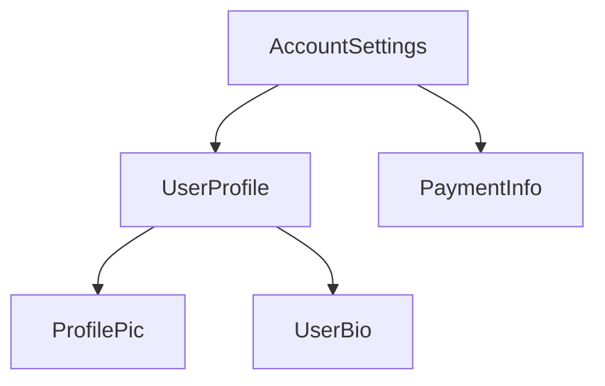

<!-- source: 9ba87c9dc81aa61dd9ed27e1cb49b76c4abe19a3 -->
<docs-decorative-header title="Anatomie d'un composant" imgSrc="adev/src/assets/images/components.svg"> <!-- markdownlint-disable-line -->
</docs-decorative-header>

TIP: Ce guide suppose que vous avez déjà lu le [guide des Fondamentaux](essentials). Commencez par celui-ci si vous découvrez Angular.

Chaque composant doit avoir :

- Une classe TypeScript avec des _comportements_, comme la gestion des saisies de l'utilisateur et la récupération de données depuis un serveur
- Un template HTML qui contrôle ce qui est rendu dans le DOM
- Un [sélecteur CSS](https://developer.mozilla.org/docs/Learn/CSS/Building_blocks/Selectors) qui définit comment le composant est utilisé dans le HTML

Vous fournissez à Angular les informations propres à un composant en ajoutant un [décorateur](https://www.typescriptlang.org/docs/handbook/decorators.html) `@Component` au-dessus de la classe TypeScript :

```angular-ts {highlight: [1, 2, 3, 4]}
@Component({
  selector: 'profile-photo',
  template: ``,
})
export class ProfilePhoto {}
```

Pour tous les détails sur l'écriture des templates Angular, notamment la liaison de données, la gestion des événements et le flux de contrôle, consultez le [guide des templates](guide/templates).

L'objet passé au décorateur `@Component` s'appelle les **métadonnées** du composant. Elles comprennent le `selector`, le `template` et d'autres propriétés décrites tout au long de ce guide.

Les composants peuvent, de façon facultative, inclure une liste de styles CSS qui s'appliquent au DOM de ce composant :

```angular-ts {highlight: [4]}
@Component({
  selector: 'profile-photo',
  template: ``,
  styles: `
    img {
      border-radius: 50%;
    }
  `,
})
export class ProfilePhoto {}
```

Par défaut, les styles d'un composant n'affectent que les éléments définis dans le template de ce composant. Consultez [Styliser les composants](guide/components/styling) pour les détails sur l'approche d'Angular en matière de styles.

Vous pouvez aussi choisir d'écrire votre template et vos styles dans des fichiers distincts :

```ts {highlight: [3,4]}
@Component({
  selector: 'profile-photo',
  templateUrl: 'profile-photo.html',
  styleUrl: 'profile-photo.css',
})
export class ProfilePhoto {}
```

Cela peut aider à séparer les préoccupations de _présentation_ de celles de _comportement_ dans votre projet. Vous pouvez choisir une approche pour l'ensemble de votre projet, ou décider laquelle utiliser pour chaque composant.

`templateUrl` et `styleUrl` sont tous deux relatifs au répertoire dans lequel se trouve le composant.

## Utiliser des composants {#using-components}

### Les imports dans le décorateur `@Component` {#imports-in-the-component-decorator}

Pour utiliser un composant, une [directive](guide/directives) ou un [pipe](guide/templates/pipes), vous devez l'ajouter
au tableau `imports` du décorateur `@Component` :

```ts
import {Component} from '@angular/core';
import {ProfilePhoto} from './profile-photo';

@Component({
  // Import the `ProfilePhoto` component in
  // order to use it in this component's template.
  imports: [ProfilePhoto],
  /* ... */
})
export class UserProfile {}
```

Par défaut, les composants Angular sont _standalone_, ce qui signifie que vous pouvez les ajouter directement au tableau `imports` d'autres composants. Les composants créés avec une version antérieure d'Angular peuvent à la place spécifier `standalone: false` dans leur décorateur `@Component`. Pour ces composants, vous importez plutôt le `NgModule` dans lequel le composant est défini. Consultez le [guide complet sur `NgModule`](guide/ngmodules/overview) pour plus de détails.

IMPORTANT: Dans les versions d'Angular antérieures à 19.0.0, l'option `standalone` vaut `false` par défaut.

### Afficher des composants dans un template {#showing-components-in-a-template}

Chaque composant définit un [sélecteur CSS](https://developer.mozilla.org/docs/Learn/CSS/Building_blocks/Selectors) :

```angular-ts {highlight: [2]}
@Component({
  selector: 'profile-photo',
  ...
})
export class ProfilePhoto { }
```

Consultez [Sélecteurs de composant](guide/components/selectors) pour les détails sur les types de sélecteurs pris en charge par Angular et des conseils pour choisir un sélecteur.

Vous affichez un composant en créant un élément HTML correspondant dans le template d'_autres_ composants :

```angular-ts {highlight: [8]}
@Component({
  selector: 'profile-photo',
})
export class ProfilePhoto {}

@Component({
  imports: [ProfilePhoto],
  template: `<profile-photo />`,
})
export class UserProfile {}
```

Angular crée une instance du composant pour chaque élément HTML correspondant qu'il rencontre. L'élément du DOM qui correspond au sélecteur d'un composant est appelé l'**élément hôte** de ce composant. Le contenu du template d'un composant est rendu à l'intérieur de son élément hôte.

Le DOM rendu par un composant, qui correspond au template de ce composant, est appelé la
**vue** de ce composant.

En composant ainsi les composants, **vous pouvez vous représenter votre application Angular comme un arbre de composants**.



Cette structure en arbre est importante pour comprendre plusieurs autres concepts d'Angular, notamment l'[injection de dépendances](guide/di) et les [requêtes d'enfants](guide/components/queries).
