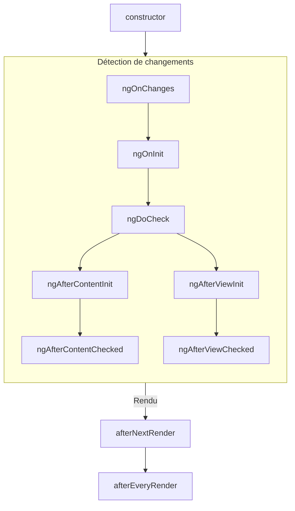
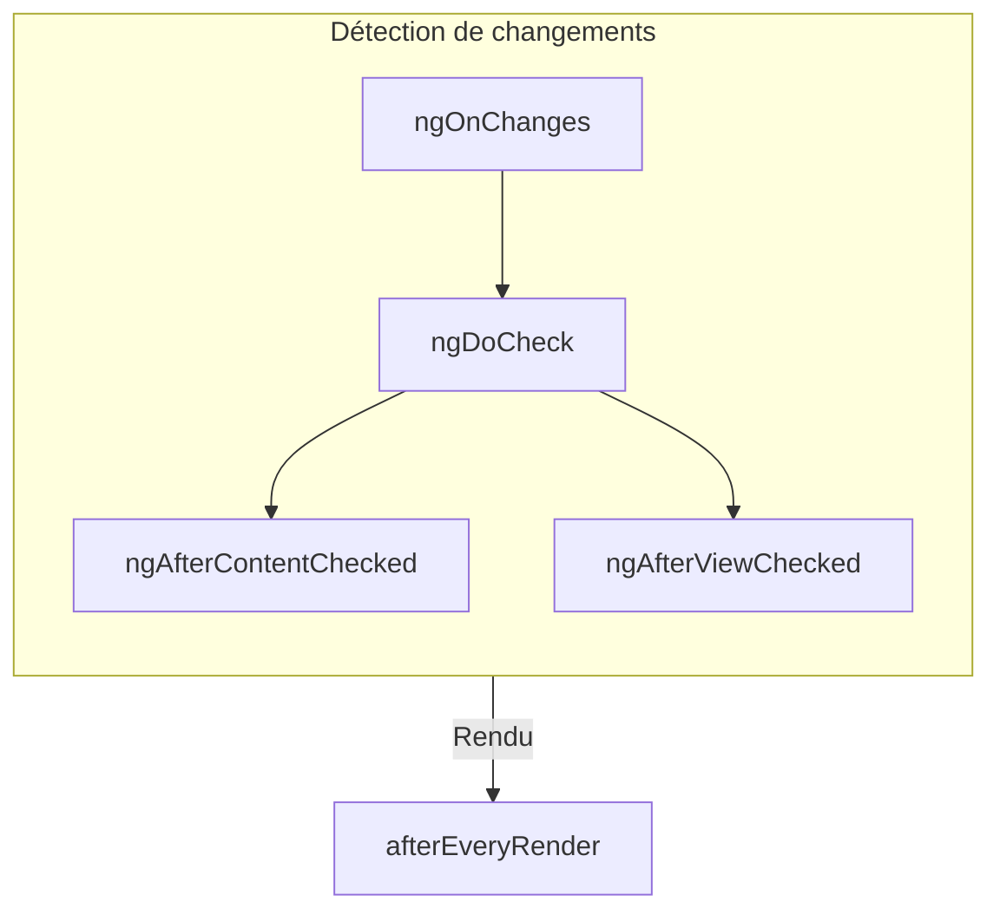

<!-- source: 7fd60e1dadbae267f5348b54e2367d76480f94d7 -->
# Cycle de vie des composants

TIP: Ce guide suppose que vous avez déjà lu le [guide des Fondamentaux](essentials). Lisez-le d'abord si vous découvrez Angular.

Le **cycle de vie** d'un composant est la séquence d'étapes qui se déroulent entre la création du composant
et sa destruction. Chaque étape représente une partie différente du processus par lequel Angular effectue le rendu
des composants et vérifie au fil du temps s'ils doivent être mis à jour.

Dans vos composants, vous pouvez implémenter des **lifecycle hooks** pour exécuter du code pendant ces étapes.
Les lifecycle hooks liés à une instance de composant précise sont implémentés comme des méthodes de votre
classe de composant. Les lifecycle hooks liés à l'application Angular dans son ensemble sont implémentés
comme des fonctions qui acceptent un callback.

Le cycle de vie d'un composant est étroitement lié à la manière dont Angular vérifie au fil du temps les changements de vos composants.
Pour comprendre ce cycle de vie, il vous suffit de savoir qu'Angular parcourt
l'arbre de votre application de haut en bas, en vérifiant les changements des bindings de template. Les lifecycle
hooks décrits ci-dessous s'exécutent pendant ce parcours. Ce parcours visite chaque
composant exactement une fois : évitez donc toujours d'apporter d'autres changements d'état au milieu du
processus.

## Résumé {#summary}

<div class="docs-table docs-scroll-track-transparent">
  <table>
    <tr>
      <td><strong>Phase</strong></td>
      <td><strong>Méthode</strong></td>
      <td><strong>Résumé</strong></td>
    </tr>
    <tr>
      <td>Création</td>
      <td><code>constructor</code></td>
      <td>
        <a href="https://developer.mozilla.org/docs/Web/JavaScript/Reference/Classes/constructor" target="_blank">
          Constructeur de classe JavaScript standard
        </a>. S'exécute quand Angular instancie le composant.
      </td>
    </tr>
    <tr>
      <td rowspan="7">Détection<br>de changements</td>
      <td><code>ngOnInit</code>
      </td>
      <td>S'exécute une fois, après qu'Angular a initialisé tous les inputs du composant.</td>
    </tr>
    <tr>
      <td><code>ngOnChanges</code></td>
      <td>S'exécute chaque fois que les inputs du composant ont changé.</td>
    </tr>
    <tr>
      <td><code>ngDoCheck</code></td>
      <td>S'exécute chaque fois que ce composant est vérifié pour détecter des changements.</td>
    </tr>
    <tr>
      <td><code>ngAfterContentInit</code></td>
      <td>S'exécute une fois, après l'initialisation du <em>contenu</em> du composant.</td>
    </tr>
    <tr>
      <td><code>ngAfterContentChecked</code></td>
      <td>S'exécute chaque fois que le contenu de ce composant a été vérifié pour détecter des changements.</td>
    </tr>
    <tr>
      <td><code>ngAfterViewInit</code></td>
      <td>S'exécute une fois, après l'initialisation de la <em>vue</em> du composant.</td>
    </tr>
    <tr>
      <td><code>ngAfterViewChecked</code></td>
      <td>S'exécute chaque fois que la vue du composant a été vérifiée pour détecter des changements.</td>
    </tr>
    <tr>
      <td rowspan="2">Rendu</td>
      <td><code>afterNextRender</code></td>
      <td>S'exécute une fois, la prochaine fois que <strong>tous</strong> les composants ont été rendus dans le DOM.</td>
    </tr>
    <tr>
      <td><code>afterEveryRender</code></td>
      <td>S'exécute chaque fois que <strong>tous</strong> les composants ont été rendus dans le DOM.</td>
    </tr>
    <tr>
      <td>Destruction</td>
      <td><code>ngOnDestroy</code></td>
      <td>S'exécute une fois, avant la destruction du composant.</td>
    </tr>
  </table>
</div>

### ngOnInit {#ngoninit}

La méthode `ngOnInit` s'exécute après qu'Angular a initialisé tous les inputs du composant avec leurs
valeurs initiales. Le `ngOnInit` d'un composant s'exécute exactement une fois.

Cette étape a lieu _avant_ l'initialisation du propre template du composant. Vous pouvez donc
mettre à jour l'état du composant en fonction des valeurs initiales de ses inputs.

### ngOnChanges {#ngonchanges}

La méthode `ngOnChanges` s'exécute après le changement de n'importe quel input du composant.

Cette étape a lieu _avant_ la vérification du propre template du composant. Vous pouvez donc mettre à jour
l'état du composant en fonction des valeurs initiales de ses inputs.

Pendant l'initialisation, le premier `ngOnChanges` s'exécute avant `ngOnInit`.

#### Inspecter les changements {#inspecting-changes}

La méthode `ngOnChanges` accepte un argument `SimpleChanges`. Cet objet est
un [`Record`](https://www.typescriptlang.org/docs/handbook/utility-types.html#recordkeys-type)
qui associe le nom de chaque input du composant à un objet `SimpleChange`. Chaque `SimpleChange` contient la
valeur précédente de l'input, sa valeur actuelle et un indicateur précisant s'il s'agit du premier changement
de l'input.

Vous pouvez, de façon facultative, passer la classe courante ou this comme premier argument générique pour un typage plus strict.

```ts
@Component({/* ... */})
export class UserProfile {
  name = input('');

  ngOnChanges(changes: SimpleChanges<UserProfile>) {
    if (changes.name) {
      console.log(`Previous: ${changes.name.previousValue}`);
      console.log(`Current: ${changes.name.currentValue}`);
      console.log(`Is first ${changes.name.firstChange}`);
    }
  }
}
```

Si vous fournissez un `alias` pour des propriétés d'input, le Record `SimpleChanges` utilise toujours le
nom de la propriété TypeScript comme clé, et non l'alias.

### ngOnDestroy {#ngondestroy}

La méthode `ngOnDestroy` s'exécute une fois, juste avant la destruction d'un composant. Angular détruit un
composant lorsqu'il n'est plus affiché sur la page, par exemple lorsqu'il est masqué par `@if` ou lors de la navigation
vers une autre page.

#### DestroyRef {#destroyref}

Comme alternative à la méthode `ngOnDestroy`, vous pouvez injecter une instance de `DestroyRef`. Vous pouvez
enregistrer un callback à invoquer lors de la destruction du composant en appelant la méthode `onDestroy`
de `DestroyRef`.

```ts
@Component({/* ... */})
export class UserProfile {
  constructor() {
    inject(DestroyRef).onDestroy(() => {
      console.log('UserProfile destruction');
    });
  }
}
```

Vous pouvez passer l'instance de `DestroyRef` à des fonctions ou à des classes situées hors de votre composant. Utilisez ce
pattern si vous avez d'autre code qui doit exécuter un nettoyage lorsque le composant est
détruit.

Vous pouvez aussi utiliser `DestroyRef` pour garder le code de mise en place près du code de nettoyage, plutôt que de placer
tout le code de nettoyage dans la méthode `ngOnDestroy`.

##### Détecter la destruction d'une instance {#detecting-instance-destruction}

`DestroyRef` fournit une propriété `destroyed` qui permet de vérifier si une instance donnée a déjà été détruite. C'est utile pour éviter des opérations sur des composants détruits, en particulier avec une logique différée ou asynchrone.

En vérifiant `destroyRef.destroyed`, vous pouvez empêcher l'exécution de code après le nettoyage de l'instance, et éviter ainsi des erreurs comme `NG0911: View has already been destroyed.`.

### ngDoCheck {#ngdocheck}

La méthode `ngDoCheck` s'exécute avant chaque vérification par Angular des changements du template d'un composant.

Vous pouvez utiliser ce lifecycle hook pour vérifier manuellement des changements d'état en dehors de la
détection de changements normale d'Angular, en mettant à jour manuellement l'état du composant.

Cette méthode s'exécute très fréquemment et peut avoir un impact important sur les performances de votre page. Évitez
de définir ce hook autant que possible, et ne l'utilisez que si vous n'avez pas d'autre solution.

Pendant l'initialisation, le premier `ngDoCheck` s'exécute après `ngOnInit`.

### ngAfterContentInit {#ngaftercontentinit}

La méthode `ngAfterContentInit` s'exécute une fois, après l'initialisation de tous les enfants imbriqués dans le composant (son
_contenu_).

Vous pouvez utiliser ce lifecycle hook pour lire les résultats des
[content queries](guide/components/queries#content-queries). Vous pouvez accéder à l'état initialisé
de ces queries, mais toute tentative de modifier un état dans cette méthode provoque une
[ExpressionChangedAfterItHasBeenCheckedError](errors/NG0100)

### ngAfterContentChecked {#ngaftercontentchecked}

La méthode `ngAfterContentChecked` s'exécute chaque fois que les enfants imbriqués dans le composant (son
_contenu_) ont été vérifiés pour détecter des changements.

Cette méthode s'exécute très fréquemment et peut avoir un impact important sur les performances de votre page. Évitez
de définir ce hook autant que possible, et ne l'utilisez que si vous n'avez pas d'autre solution.

Vous pouvez accéder ici à l'état mis à jour
des [content queries](guide/components/queries#content-queries), mais toute tentative de
modifier un état dans cette méthode provoque
une [ExpressionChangedAfterItHasBeenCheckedError](errors/NG0100).

### ngAfterViewInit {#ngafterviewinit}

La méthode `ngAfterViewInit` s'exécute une fois, après l'initialisation de tous les enfants du template du composant (sa
_vue_).

Vous pouvez utiliser ce lifecycle hook pour lire les résultats des
[view queries](guide/components/queries#view-queries). Vous pouvez accéder à l'état initialisé de
ces queries, mais toute tentative de modifier un état dans cette méthode provoque une
[ExpressionChangedAfterItHasBeenCheckedError](errors/NG0100)

### ngAfterViewChecked {#ngafterviewchecked}

La méthode `ngAfterViewChecked` s'exécute chaque fois que les enfants du template du composant (sa
_vue_) ont été vérifiés pour détecter des changements.

Cette méthode s'exécute très fréquemment et peut avoir un impact important sur les performances de votre page. Évitez
de définir ce hook autant que possible, et ne l'utilisez que si vous n'avez pas d'autre solution.

Vous pouvez accéder à l'état mis à jour des [view queries](guide/components/queries#view-queries)
ici, mais toute tentative de
modifier un état dans cette méthode provoque
une [ExpressionChangedAfterItHasBeenCheckedError](errors/NG0100).

### afterEveryRender et afterNextRender {#aftereveryrender-and-afternextrender}

Les fonctions `afterEveryRender` et `afterNextRender` vous permettent d'enregistrer un **callback de rendu** à
invoquer après qu'Angular a terminé le rendu de _tous les composants_ de la page dans le DOM.

Ces fonctions diffèrent des autres lifecycle hooks décrits dans ce guide. Au lieu d'une
méthode de classe, ce sont des fonctions standalone qui acceptent un callback. L'exécution des callbacks
de rendu n'est liée à aucune instance de composant précise : il s'agit d'un hook à l'échelle de l'application.

`afterEveryRender` et `afterNextRender` doivent être appelées dans
un [contexte d'injection](guide/di/dependency-injection-context), généralement le
constructeur d'un composant.

Vous pouvez utiliser les callbacks de rendu pour effectuer des opérations manuelles sur le DOM.
Consultez [Utiliser les API du DOM](guide/components/dom-apis) pour savoir comment manipuler le DOM dans Angular.

Les callbacks de rendu ne s'exécutent ni pendant le rendu côté serveur (SSR), ni pendant le prérendu au moment du build.

#### Phases de after\*Render {#afterrender-phases}

Avec `afterEveryRender` ou `afterNextRender`, vous pouvez, de façon facultative, découper le travail en phases. La
phase vous permet de contrôler l'enchaînement des opérations sur le DOM, en plaçant les opérations d'_écriture_
avant les opérations de _lecture_ afin de minimiser le
[layout thrashing](https://web.dev/avoid-large-complex-layouts-and-layout-thrashing). Pour
communiquer d'une phase à l'autre, une fonction de phase peut renvoyer une valeur de résultat accessible dans la
phase suivante.

```ts
import {Component, ElementRef, afterNextRender, inject} from '@angular/core';

@Component(/* ... */)
export class UserProfile {
  private prevPadding = 0;
  private elementHeight = 0;

  constructor() {
    const elementRef = inject(ElementRef);
    const nativeElement = elementRef.nativeElement;

    afterNextRender({
      // Use the `Write` phase to write to a geometric property.
      write: () => {
        const padding = computePadding();
        const changed = padding !== this.prevPadding;
        if (changed) {
          nativeElement.style.padding = padding;
        }
        return changed; // Communicate whether anything changed to the read phase.
      },

      // Use the `Read` phase to read geometric properties after all writes have occurred.
      read: (didWrite) => {
        if (didWrite) {
          this.elementHeight = nativeElement.getBoundingClientRect().height;
        }
      },
    });
  }
}
```

Il existe quatre phases, exécutées dans l'ordre suivant :

| Phase            | Description                                                                                                                                                                                           |
| ---------------- | ----------------------------------------------------------------------------------------------------------------------------------------------------------------------------------------------------- |
| `earlyRead`      | Utilisez cette phase pour lire les propriétés et les styles du DOM qui affectent la mise en page et qui sont strictement nécessaires aux calculs suivants. Évitez cette phase si possible, en privilégiant les phases `write` et `read`. |
| `write`          | Utilisez cette phase pour écrire les propriétés et les styles du DOM qui affectent la mise en page.                                                                                                                                   |
| `mixedReadWrite` | Phase par défaut. Utilisez-la pour toute opération qui doit à la fois lire et écrire des propriétés et des styles affectant la mise en page. Évitez cette phase si possible, en privilégiant les phases explicites `write` et `read`.            |
| `read`           | Utilisez cette phase pour lire les propriétés du DOM qui affectent la mise en page.                                                                                                                                           |

## Interfaces de cycle de vie {#lifecycle-interfaces}

Angular fournit une interface TypeScript pour chaque méthode de cycle de vie. Vous pouvez, de façon facultative, importer
et les implémenter (`implement`) pour vous assurer que votre implémentation ne contient aucune faute de frappe ou
d'orthographe.

Chaque interface porte le même nom que la méthode correspondante, sans le préfixe `ng`. Par exemple,
l'interface de `ngOnInit` est `OnInit`.

```ts
@Component({/* ... */})
export class UserProfile implements OnInit {
  ngOnInit() {
    /* ... */
  }
}
```

## Ordre d'exécution {#execution-order}

Les diagrammes suivants montrent l'ordre d'exécution des lifecycle hooks d'Angular.

### Pendant l'initialisation {#during-initialization}



### Mises à jour suivantes {#subsequent-updates}



### Ordre avec les directives {#ordering-with-directives}

Lorsque vous placez une ou plusieurs directives sur le même élément qu'un composant, que ce soit dans un template ou avec
la propriété `hostDirectives`, le framework ne garantit aucun ordre d'exécution d'un lifecycle hook donné
entre le composant et les directives d'un même élément. Ne vous fiez jamais à un ordre
observé, car il peut changer dans les versions ultérieures d'Angular.
