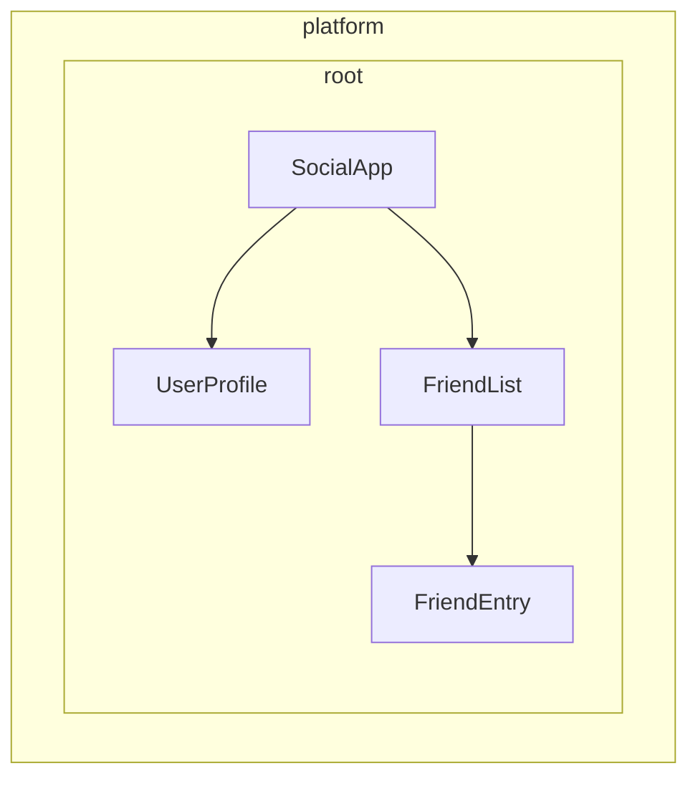

<!-- source: 3d620f02b0d1c6b3a3f880db806462f898a1a0ac -->
# Définir des providers de dépendances

Angular propose deux façons de rendre des services disponibles pour l'injection :

1. **Fourniture automatique** - En utilisant `providedIn` dans le décorateur `@Injectable`, le décorateur [`@Service`](guide/di/creating-and-using-services#using-the-service-vs-injectable-decorator), ou en fournissant une fabrique dans la configuration de l'`InjectionToken`
2. **Fourniture manuelle** - En utilisant le tableau `providers` dans les composants, les directives, les routes ou la configuration de l'application

Dans le [guide précédent](/guide/di/creating-and-using-services), vous avez appris à créer des services avec `providedIn: 'root'`, qui couvre la plupart des cas d'usage courants. Ce guide explore d'autres patterns de configuration des providers, automatique comme manuelle.

## Fourniture automatique pour les dépendances qui ne sont pas des classes {#automatic-provision-for-non-class-dependencies}

Si le décorateur `@Injectable` avec `providedIn: 'root'` fonctionne très bien pour les services (des classes), vous pourriez avoir besoin de fournir globalement d'autres types de valeurs, comme des objets de configuration, des fonctions ou des valeurs primitives. Angular propose `InjectionToken` à cet effet.

### Qu'est-ce qu'un InjectionToken ? {#what-is-an-injectiontoken}

Un `InjectionToken` est un objet que le système d'injection de dépendances d'Angular utilise pour identifier de manière unique les valeurs à injecter. Voyez-le comme une clé spéciale qui vous permet de stocker et de récupérer n'importe quel type de valeur dans le système de DI d'Angular :

```ts
import {InjectionToken} from '@angular/core';

// Create a token for a string value
export const API_URL = new InjectionToken<string>('api.url');

// Create a token for a function
export const LOGGER = new InjectionToken<(msg: string) => void>('logger.function');

// Create a token for a complex type
export interface Config {
  apiUrl: string;
  timeout: number;
}
export const CONFIG_TOKEN = new InjectionToken<Config>('app.config');
```

NOTE: Le paramètre de type chaîne (par exemple `'api.url'`) est une description destinée uniquement au débogage : Angular identifie les jetons par leur référence d'objet, et non par cette chaîne.

### InjectionToken avec `providedIn: 'root'` {#injectiontoken-with-providedin-root}

Un `InjectionToken` qui possède une `factory` est par défaut en `providedIn: 'root'` (mais cela peut être remplacé via la propriété `providedIn`).

```ts {header: "/app/config.token.ts"}
import {InjectionToken, Component, inject} from '@angular/core';

export interface AppConfig {
  apiUrl: string;
  version: string;
  features: Record<string, boolean>;
}

// Globally available configuration using providedIn
export const APP_CONFIG = new InjectionToken<AppConfig>('app.config', {
  providedIn: 'root',
  factory: () => ({
    apiUrl: 'https://api.example.com',
    version: '1.0.0',
    features: {
      darkMode: true,
      analytics: false,
    },
  }),
});

// No need to add to providers array - available everywhere!
@Component({
  selector: 'app-header',
  template: `<h1>Version: {{ config.version }}</h1>`,
})
export class Header {
  config = inject(APP_CONFIG); // Automatically available
}
```

### Quand utiliser un InjectionToken avec des fonctions de fabrique {#when-to-use-injectiontoken-with-factory-functions}

Un InjectionToken avec une fonction de fabrique est idéal quand vous ne pouvez pas utiliser de classe mais devez fournir des dépendances globalement :

```ts {header: "/app/logger.token.ts"}
import {InjectionToken, inject} from '@angular/core';
import {APP_CONFIG} from './config.token';

// Logger function type
export type LoggerFn = (level: string, message: string) => void;

// Global logger function with dependencies
export const LOGGER_FN = new InjectionToken<LoggerFn>('logger.function', {
  providedIn: 'root',
  factory: () => {
    const config = inject(APP_CONFIG);

    return (level: string, message: string) => {
      if (config.features.logging !== false) {
        console[level](`[${new Date().toISOString()}] ${message}`);
      }
    };
  },
});
```

```ts {header: "/app/storage.token.ts"}
// Providing browser APIs as tokens
export const LOCAL_STORAGE = new InjectionToken<Storage>('localStorage', {
  // providedIn: 'root' is configured as the default
  factory: () => window.localStorage,
});

export const SESSION_STORAGE = new InjectionToken<Storage>('sessionStorage', {
  providedIn: 'root',
  factory: () => window.sessionStorage,
});
```

```ts {header: "/app/feature-flags.token.ts"}
// Complex configuration with runtime logic
export const FEATURE_FLAGS = new InjectionToken<Map<string, boolean>>('feature.flags', {
  providedIn: 'root',
  factory: () => {
    const flags = new Map<string, boolean>();

    // Parse from environment or URL params
    const urlParams = new URLSearchParams(window.location.search);
    const enableBeta = urlParams.get('beta') === 'true';

    flags.set('betaFeatures', enableBeta);
    flags.set('darkMode', true);
    flags.set('newDashboard', false);

    return flags;
  },
});
```

Cette approche offre plusieurs avantages :

- **Aucune configuration manuelle de provider nécessaire** - Fonctionne exactement comme `providedIn: 'root'` pour les services
- **Compatible avec le tree-shaking** - Inclus uniquement s'il est réellement utilisé
- **Typage sûr** - Prise en charge complète de TypeScript pour les valeurs qui ne sont pas des classes
- **Peut injecter d'autres dépendances** - Les fonctions de fabrique peuvent utiliser `inject()` pour accéder à d'autres services

## Comprendre la configuration manuelle des providers {#understanding-manual-provider-configuration}

Quand vous avez besoin de plus de contrôle que ce qu'offre `providedIn: 'root'`, vous pouvez configurer manuellement les providers. La configuration manuelle via le tableau `providers` est utile quand :

1. **Le service n'a pas de `providedIn`** - Les services sans fourniture automatique doivent être fournis manuellement
2. **Vous voulez une nouvelle instance** - Pour créer une instance distincte au niveau du composant ou de la directive au lieu d'utiliser l'instance partagée
3. **Vous avez besoin d'une configuration à l'exécution** - Quand le comportement du service dépend de valeurs connues à l'exécution
4. **Vous fournissez des valeurs qui ne sont pas des classes** - Objets de configuration, fonctions ou valeurs primitives

### Exemple : service sans `providedIn` {#example-service-without-providedin}

```ts
import {Injectable, Component, inject} from '@angular/core';

// Service without providedIn
@Injectable()
export class LocalDataStore {
  private data: string[] = [];

  addData(item: string) {
    this.data.push(item);
  }
}

// Component must provide it
@Component({
  selector: 'app-example',
  // A provider is required here because the `LocalDataStore` service has no providedIn.
  providers: [LocalDataStore],
  template: `...`,
})
export class Example {
  dataStore = inject(LocalDataStore);
}
```

### Exemple : créer des instances propres à un composant {#example-creating-component-specific-instances}

Les services avec `providedIn: 'root'` peuvent être remplacés au niveau du composant. Cela lie l'instance du service à la durée de vie d'un composant. Par conséquent, quand le composant est détruit, le service fourni est lui aussi détruit.

```ts
import {Injectable, Component, inject} from '@angular/core';

@Injectable({providedIn: 'root'})
export class DataStore {
  private data: ListItem[] = [];
}

// This component gets its own instance
@Component({
  selector: 'app-isolated',
  // Creates new instance of `DataStore` rather than using the root-provided instance.
  providers: [DataStore],
  template: `...`,
})
export class Isolated {
  dataStore = inject(DataStore); // Component-specific instance
}
```

## Hiérarchie des injectors dans Angular {#injector-hierarchy-in-angular}

Le système d'injection de dépendances d'Angular est hiérarchique. Quand un composant demande une dépendance, Angular commence par l'injector de ce composant et remonte l'arbre jusqu'à trouver un provider pour cette dépendance. Chaque composant de l'arbre de votre application peut avoir son propre injector, et ces injectors forment une hiérarchie qui reflète votre arbre de composants.

Cette hiérarchie permet :

- **Des instances avec portée** : différentes parties de votre application peuvent avoir différentes instances du même service
- **Le remplacement de comportement** : les composants enfants peuvent remplacer les providers des composants parents
- **L'efficacité mémoire** : les services ne sont instanciés que là où c'est nécessaire

Dans Angular, tout élément portant un composant ou une directive peut fournir des valeurs à tous ses descendants.



Dans l'exemple ci-dessus :

1. `SocialApp` peut fournir des valeurs pour `UserProfile` et `FriendList`
2. `FriendList` peut fournir des valeurs à injecter dans `FriendEntry`, mais ne peut pas fournir de valeurs à injecter dans `UserProfile` car celui-ci ne fait pas partie de son arbre

## Déclarer un provider {#declaring-a-provider}

Voyez le système d'injection de dépendances d'Angular comme une table de hachage ou un dictionnaire. Chaque objet de configuration de provider définit une paire clé-valeur :

- **Clé (identifiant du provider)** : l'identifiant unique que vous utilisez pour demander une dépendance
- **Valeur** : ce qu'Angular doit renvoyer quand ce jeton est demandé

Quand vous fournissez manuellement des dépendances, vous voyez généralement cette syntaxe abrégée :

```angular-ts
import {Component} from '@angular/core';
import {LocalService} from './local-service';

@Component({
  selector: 'app-example',
  providers: [LocalService], // Service without providedIn
})
export class Example {}
```

Il s'agit en réalité d'un raccourci pour une configuration de provider plus détaillée :

```ts
{
  // This is the shorthand version
  providers: [LocalService],

  // This is the full version
  providers: [
    { provide: LocalService, useClass: LocalService }
  ]
}
```

### Objet de configuration de provider {#provider-configuration-object}

Chaque objet de configuration de provider comporte deux parties principales :

1. **Identifiant du provider** : la clé unique qu'Angular utilise pour obtenir la dépendance (définie via la propriété `provide`)
2. **Valeur** : la dépendance réelle qu'Angular doit récupérer, configurée avec différentes clés selon le type souhaité :
   - `useClass` - Fournit une classe JavaScript
   - `useValue` - Fournit une valeur statique
   - `useFactory` - Fournit une fonction de fabrique qui renvoie la valeur
   - `useExisting` - Fournit un alias vers un provider existant

### Identifiants de provider {#provider-identifiers}

Les identifiants de provider permettent au système d'injection de dépendances (DI) d'Angular de récupérer une dépendance grâce à un ID unique. Vous pouvez générer des identifiants de provider de deux façons :

1. [Noms de classe](#class-names)
2. [Jetons d'injection](#injection-tokens)

#### Noms de classe {#class-names}

Les noms de classe utilisent directement la classe importée comme identifiant :

```angular-ts
import {Component} from '@angular/core';
import {LocalService} from './local-service';

@Component({
  selector: 'app-example',
  providers: [{provide: LocalService, useClass: LocalService}],
})
export class Example {
  /* ... */
}
```

La classe sert à la fois d'identifiant et d'implémentation, c'est pourquoi Angular propose le raccourci `providers: [LocalService]`.

#### Jetons d'injection {#injection-tokens}

Angular fournit une classe [`InjectionToken`](api/core/InjectionToken) intégrée qui crée une référence d'objet unique pour des valeurs injectables, ou quand vous voulez fournir plusieurs implémentations de la même interface.

```ts {header: "/app/tokens.ts"}
import {InjectionToken} from '@angular/core';
import {DataService} from './data-service.interface';

export const DATA_SERVICE_TOKEN = new InjectionToken<DataService>('DataService');
```

NOTE: La chaîne `'DataService'` est une description utilisée uniquement à des fins de débogage. Angular identifie le jeton par sa référence d'objet, et non par cette chaîne.

Utilisez le jeton dans la configuration de votre provider :

```angular-ts
import {Component, inject} from '@angular/core';
import {LocalDataService} from './local-data-service';
import {DATA_SERVICE_TOKEN} from './tokens';

@Component({
  selector: 'app-example',
  providers: [{provide: DATA_SERVICE_TOKEN, useClass: LocalDataService}],
})
export class Example {
  private dataService = inject(DATA_SERVICE_TOKEN);
}
```

#### Les interfaces TypeScript peuvent-elles servir d'identifiants pour l'injection ? {#can-typescript-interfaces-be-identifiers-for-injection}

Les interfaces TypeScript ne peuvent pas être utilisées pour l'injection, car elles n'existent pas à l'exécution :

```ts
// ❌ This won't work!
interface DataService {
  getData(): string[];
}

// Interfaces disappear after TypeScript compilation
@Component({
  providers: [
    {provide: DataService, useClass: LocalDataService}, // Error!
  ],
})
export class Example {
  private dataService = inject(DataService); // Error!
}

// ✅ Use InjectionToken instead
export const DATA_SERVICE_TOKEN = new InjectionToken<DataService>('DataService');

@Component({
  providers: [{provide: DATA_SERVICE_TOKEN, useClass: LocalDataService}],
})
export class Example {
  private dataService = inject(DATA_SERVICE_TOKEN); // Works!
}
```

L'InjectionToken fournit une valeur à l'exécution que le système de DI d'Angular peut utiliser, tout en conservant la sûreté du typage grâce au paramètre de type générique de TypeScript.

### Types de valeurs de provider {#provider-value-types}

#### useClass

`useClass` fournit une classe JavaScript comme dépendance. C'est le comportement par défaut avec la syntaxe abrégée :

```ts
// Shorthand
providers: [DataService];

// Full syntax
providers: [{provide: DataService, useClass: DataService}];

// Different implementation
providers: [{provide: DataService, useClass: MockDataService}];

// Conditional implementation
providers: [
  {
    provide: StorageService,
    useClass: environment.production ? CloudStorageService : LocalStorageService,
  },
];
```

#### Exemple pratique : substitution du logger {#practical-example-logger-substitution}

Vous pouvez substituer des implémentations pour étendre des fonctionnalités :

```ts
import {Injectable, Component, inject} from '@angular/core';

// Base logger
@Injectable()
export class Logger {
  log(message: string) {
    console.log(message);
  }
}

// Enhanced logger with timestamp
@Injectable()
export class BetterLogger extends Logger {
  override log(message: string) {
    super.log(`[${new Date().toISOString()}] ${message}`);
  }
}

// Logger that includes user context
@Injectable()
export class EvenBetterLogger extends Logger {
  private userService = inject(UserService);

  override log(message: string) {
    const name = this.userService.user.name;
    super.log(`Message to ${name}: ${message}`);
  }
}

// In your component
@Component({
  selector: 'app-example',
  providers: [
    UserService, // EvenBetterLogger needs this
    {provide: Logger, useClass: EvenBetterLogger},
  ],
})
export class Example {
  private logger = inject(Logger); // Gets EvenBetterLogger instance
}
```

#### useValue

`useValue` fournit n'importe quel type de données JavaScript comme valeur statique :

```ts
providers: [
  {provide: API_URL_TOKEN, useValue: 'https://api.example.com'},
  {provide: MAX_RETRIES_TOKEN, useValue: 3},
  {provide: FEATURE_FLAGS_TOKEN, useValue: {darkMode: true, beta: false}},
];
```

IMPORTANT: Les types et interfaces TypeScript ne peuvent pas servir de valeurs de dépendance. Ils n'existent qu'à la compilation.

#### Exemple pratique : configuration de l'application {#practical-example-application-configuration}

Un cas d'usage courant de `useValue` est de fournir la configuration de l'application :

```ts
// Define configuration interface
export interface AppConfig {
  apiUrl: string;
  appTitle: string;
  features: {
    darkMode: boolean;
    analytics: boolean;
  };
}

// Create injection token
export const APP_CONFIG = new InjectionToken<AppConfig>('app.config');

// Define configuration
const appConfig: AppConfig = {
  apiUrl: 'https://api.example.com',
  appTitle: 'My Application',
  features: {
    darkMode: true,
    analytics: false,
  },
};

// Provide in bootstrap
bootstrapApplication(AppComponent, {
  providers: [{provide: APP_CONFIG, useValue: appConfig}],
});

// Use in component
@Component({
  selector: 'app-header',
  template: `<h1>{{ title }}</h1>`,
})
export class Header {
  private config = inject(APP_CONFIG);
  title = this.config.appTitle;
}
```

#### useFactory

`useFactory` fournit une fonction qui génère une nouvelle valeur à injecter :

```ts
export const loggerFactory = (config: AppConfig) => {
  return new LoggerService(config.logLevel, config.endpoint);
};

providers: [
  {
    provide: LoggerService,
    useFactory: loggerFactory,
    deps: [APP_CONFIG], // Dependencies for the factory function
  },
];
```

Vous pouvez marquer des dépendances de la fabrique comme optionnelles :

```ts
import {Optional} from '@angular/core';

providers: [
  {
    provide: MyService,
    useFactory: (required: RequiredService, optional?: OptionalService) => {
      return new MyService(required, optional || new DefaultService());
    },
    deps: [RequiredService, [new Optional(), OptionalService]],
  },
];
```

#### Exemple pratique : client d'API basé sur la configuration {#practical-example-configuration-based-api-client}

Voici un exemple complet qui montre comment utiliser une fabrique pour créer un service avec une configuration connue à l'exécution :

```ts
// Service that needs runtime configuration
class ApiClient {
  constructor(
    private http: HttpClient,
    private baseUrl: string,
    private rateLimitMs: number,
  ) {}

  async fetchData(endpoint: string) {
    // Apply rate limiting based on user tier
    await this.applyRateLimit();
    return this.http.get(`${this.baseUrl}/${endpoint}`);
  }

  private async applyRateLimit() {
    // Simplified example - real implementation would track request timing
    return new Promise((resolve) => setTimeout(resolve, this.rateLimitMs));
  }
}

// Factory function that configures based on user tier
import {inject, Component} from '@angular/core';
import {HttpClient} from '@angular/common/http';
const apiClientFactory = () => {
  const http = inject(HttpClient);
  const userService = inject(UserService);

  // Assuming userService provides these values
  const baseUrl = userService.getApiBaseUrl();
  const rateLimitMs = userService.getRateLimit();

  return new ApiClient(http, baseUrl, rateLimitMs);
};

// Provider configuration
export const apiClientProvider = {
  provide: ApiClient,
  useFactory: apiClientFactory,
};

// Usage in component
@Component({
  selector: 'app-dashboard',
  providers: [apiClientProvider],
})
export class Dashboard {
  private apiClient = inject(ApiClient);
}
```

#### useExisting

`useExisting` crée un alias vers un provider déjà défini. Les deux jetons renvoient la même instance :

```ts
providers: [
  NewLogger, // The actual service
  {provide: OldLogger, useExisting: NewLogger}, // The alias
];
```

IMPORTANT: Ne confondez pas `useExisting` avec `useClass`. `useClass` crée des instances distinctes, tandis que `useExisting` garantit que vous obtenez la même instance singleton.

### Providers multiples {#multiple-providers}

Utilisez l'option `multi: true` quand plusieurs providers contribuent des valeurs au même jeton :

```ts
export const INTERCEPTOR_TOKEN = new InjectionToken<Interceptor[]>('interceptors');

providers: [
  {provide: INTERCEPTOR_TOKEN, useClass: AuthInterceptor, multi: true},
  {provide: INTERCEPTOR_TOKEN, useClass: LoggingInterceptor, multi: true},
  {provide: INTERCEPTOR_TOKEN, useClass: RetryInterceptor, multi: true},
];
```

Quand vous injectez `INTERCEPTOR_TOKEN`, vous recevez un tableau contenant les instances des trois intercepteurs.

## Où pouvez-vous déclarer des providers ? {#where-can-you-specify-providers}

Angular propose plusieurs niveaux où enregistrer des providers, chacun ayant des implications différentes sur la portée, le cycle de vie et les performances :

- [**Bootstrap de l'application**](#application-bootstrap) - Des singletons globaux disponibles partout
- [**Sur un élément (composant ou directive)**](#component-or-directive-providers) - Des instances isolées pour des arbres de composants spécifiques
- [**Route**](#route-providers) - Des services propres à une fonctionnalité pour les modules chargés en lazy loading

### Bootstrap de l'application {#application-bootstrap}

Utilisez des providers au niveau de l'application dans `bootstrapApplication` quand :

- **Le service est utilisé dans plusieurs domaines fonctionnels** - Des services comme les clients HTTP, la journalisation ou l'authentification, dont de nombreuses parties de votre application ont besoin
- **Vous voulez un vrai singleton** - Une seule instance partagée par toute l'application
- **Le service n'a pas de configuration propre à un composant** - Des utilitaires génériques qui fonctionnent de la même façon partout
- **Vous fournissez une configuration globale** - Points de terminaison d'API, feature flags ou paramètres d'environnement

```ts {header: "main.ts"}
bootstrapApplication(App, {
  providers: [
    {provide: API_BASE_URL, useValue: 'https://api.example.com'},
    {provide: INTERCEPTOR_TOKEN, useClass: AuthInterceptor, multi: true},
    LoggingService, // Used throughout the app
    {provide: ErrorHandler, useClass: GlobalErrorHandler},
  ],
});
```

**Avantages :**

- Une instance unique réduit la consommation de mémoire
- Disponible partout sans configuration supplémentaire
- Plus simple pour gérer l'état global

**Inconvénients :**

- Toujours inclus dans votre bundle JavaScript, même si la valeur n'est jamais injectée
- Difficile à personnaliser par fonctionnalité
- Plus difficile de tester des composants individuels de manière isolée

#### Pourquoi fournir au bootstrap plutôt qu'utiliser `providedIn: 'root'` ? {#why-provide-during-bootstrap-instead-of-using-providedin-root}

Vous pourriez vouloir un provider au bootstrap quand :

- Le provider a des effets de bord (par exemple, l'installation du router côté client)
- Le provider nécessite une configuration (par exemple, des routes)
- Vous utilisez le pattern `provideSomething` d'Angular (par exemple, `provideRouter`, `provideHttpClient`)

### Providers de composant ou de directive {#component-or-directive-providers}

Utilisez des providers de composant ou de directive quand :

- **Le service a un état propre au composant** - Validateurs de formulaire, caches propres à un composant ou gestionnaires d'état d'interface
- **Vous avez besoin d'instances isolées** - Chaque composant a besoin de sa propre copie du service
- **Le service n'est utilisé que par un seul arbre de composants** - Des services spécialisés qui n'ont pas besoin d'un accès global
- **Vous créez des composants réutilisables** - Des composants qui doivent fonctionner de manière indépendante avec leurs propres services

```angular-ts
// Specialized form component with its own validation service
@Component({
  selector: 'app-advanced-form',
  providers: [
    FormValidationService, // Each form gets its own validator
    {provide: FORM_CONFIG, useValue: {strictMode: true}},
  ],
})
export class AdvancedForm {}

// Modal component with isolated state management
@Component({
  selector: 'app-modal',
  providers: [
    ModalStateService, // Each modal manages its own state
  ],
})
export class Modal {}
```

**Avantages :**

- Meilleure encapsulation et meilleure isolation
- Plus simple de tester les composants individuellement
- Plusieurs instances peuvent coexister avec des configurations différentes

**Inconvénients :**

- Une nouvelle instance est créée pour chaque composant (consommation de mémoire plus élevée)
- Aucun état partagé entre les composants
- Doit être fourni partout où c'est nécessaire
- Toujours inclus dans le même bundle JavaScript que le composant ou la directive, même si la valeur n'est jamais injectée

NOTE: Si plusieurs directives sur le même élément fournissent le même jeton, l'une d'elles l'emporte, mais laquelle n'est pas définie.

### Providers de route {#route-providers}

Utilisez des providers au niveau de la route pour :

- **Les services propres à une fonctionnalité** - Des services nécessaires uniquement pour certaines routes ou certains modules de fonctionnalité
- **Les dépendances des modules chargés en lazy loading** - Des services qui ne doivent être chargés qu'avec certaines fonctionnalités
- **La configuration propre à une route** - Des paramètres qui varient selon la zone de l'application

```ts {header: "routes.ts"}
export const routes: Routes = [
  {
    path: 'admin',
    providers: [
      AdminService, // Only loaded with admin routes
      {provide: FEATURE_FLAGS, useValue: {adminMode: true}},
    ],
    loadChildren: () => import('./admin/admin.routes'),
  },
  {
    path: 'shop',
    providers: [
      ShoppingCartService, // Isolated shopping state
      PaymentService,
    ],
    loadChildren: () => import('./shop/shop.routes'),
  },
];
```

Les services fournis au niveau de la route sont disponibles pour tous les composants et toutes les directives de cette route, ainsi que pour ses guards et ses resolvers.

Comme ces services sont instanciés indépendamment des composants de la route, ils n'ont pas directement accès aux informations propres à la route.

## Patterns pour les auteurs de libraries {#library-author-patterns}

Quand vous créez une library Angular, vous devez souvent proposer des options de configuration flexibles à ses utilisateurs tout en conservant des API propres. Les libraries d'Angular elles-mêmes illustrent des patterns puissants pour y parvenir.

### Le pattern `provide` {#the-provide-pattern}

Au lieu d'obliger les utilisateurs à configurer manuellement des providers complexes, les auteurs de libraries peuvent exporter des fonctions qui renvoient des configurations de providers :

```ts {header: "/libs/analytics/src/providers.ts"}
import {InjectionToken, Provider, inject} from '@angular/core';

// Configuration interface
export interface AnalyticsConfig {
  trackingId: string;
  enableDebugMode?: boolean;
  anonymizeIp?: boolean;
}

// Internal token for configuration
const ANALYTICS_CONFIG = new InjectionToken<AnalyticsConfig>('analytics.config');

// Main service that uses the configuration
export class AnalyticsService {
  private config = inject(ANALYTICS_CONFIG);

  track(event: string, properties?: any) {
    // Implementation using config
  }
}

// Provider function for consumers
export function provideAnalytics(config: AnalyticsConfig): Provider[] {
  return [{provide: ANALYTICS_CONFIG, useValue: config}, AnalyticsService];
}
```

```ts {header: "main.ts"}
// Usage in consumer app
bootstrapApplication(App, {
  providers: [
    provideAnalytics({
      trackingId: 'GA-12345',
      enableDebugMode: !environment.production,
    }),
  ],
});
```

### Patterns de providers avancés avec options {#advanced-provider-patterns-with-options}

Pour des scénarios plus complexes, vous pouvez combiner plusieurs approches de configuration :

```ts {header: "/libs/http-client/src/provider.ts"}
import {Provider, InjectionToken, inject} from '@angular/core';
import {bootstrapApplication} from '@angular/platform-browser';

// Feature flags for optional functionality
export enum HttpFeatures {
  Interceptors = 'interceptors',
  Caching = 'caching',
  Retry = 'retry',
}

// Configuration interfaces
export interface HttpConfig {
  baseUrl?: string;
  timeout?: number;
  headers?: Record<string, string>;
}

export interface RetryConfig {
  maxAttempts: number;
  delayMs: number;
}

// Internal tokens
const HTTP_CONFIG = new InjectionToken<HttpConfig>('http.config');
const RETRY_CONFIG = new InjectionToken<RetryConfig>('retry.config');
const HTTP_FEATURES = new InjectionToken<Set<HttpFeatures>>('http.features');

// Core service
class HttpClientService {
  private config = inject(HTTP_CONFIG, {optional: true});
  private features = inject(HTTP_FEATURES);

  get(url: string) {
    // Use config and check features
  }
}

// Feature services
class RetryInterceptor {
  private config = inject(RETRY_CONFIG);
  // Retry logic
}

class CacheInterceptor {
  // Caching logic
}

// Main provider function
export function provideHttpClient(config?: HttpConfig, ...features: HttpFeature[]): Provider[] {
  const providers: Provider[] = [
    {provide: HTTP_CONFIG, useValue: config || {}},
    {provide: HTTP_FEATURES, useValue: new Set(features.map((f) => f.kind))},
    HttpClientService,
  ];

  // Add feature-specific providers
  features.forEach((feature) => {
    providers.push(...feature.providers);
  });

  return providers;
}

// Feature configuration functions
export interface HttpFeature {
  kind: HttpFeatures;
  providers: Provider[];
}

export function withInterceptors(...interceptors: any[]): HttpFeature {
  return {
    kind: HttpFeatures.Interceptors,
    providers: interceptors.map((interceptor) => ({
      provide: INTERCEPTOR_TOKEN,
      useClass: interceptor,
      multi: true,
    })),
  };
}

export function withCaching(): HttpFeature {
  return {
    kind: HttpFeatures.Caching,
    providers: [CacheInterceptor],
  };
}

export function withRetry(config: RetryConfig): HttpFeature {
  return {
    kind: HttpFeatures.Retry,
    providers: [{provide: RETRY_CONFIG, useValue: config}, RetryInterceptor],
  };
}

// Consumer usage with multiple features
bootstrapApplication(App, {
  providers: [
    provideHttpClient(
      {baseUrl: 'https://api.example.com'},
      withInterceptors(AuthInterceptor, LoggingInterceptor),
      withCaching(),
      withRetry({maxAttempts: 3, delayMs: 1000}),
    ),
  ],
});
```

### Pourquoi utiliser des fonctions de provider plutôt qu'une configuration directe ? {#why-use-provider-functions-instead-of-direct-configuration}

Les fonctions de provider offrent plusieurs avantages aux auteurs de libraries :

1. **Encapsulation** - Les jetons internes et les détails d'implémentation restent privés
2. **Typage sûr** - TypeScript garantit une configuration correcte à la compilation
3. **Flexibilité** - Composez facilement des fonctionnalités avec le pattern `with*`
4. **Pérennité** - L'implémentation interne peut évoluer sans casser le code des utilisateurs
5. **Cohérence** - S'aligne sur les propres patterns d'Angular (`provideRouter`, `provideHttpClient`, etc.)

Ce pattern est largement utilisé dans les libraries d'Angular elles-mêmes et est considéré comme une bonne pratique pour les auteurs de libraries qui doivent fournir des services configurables.
