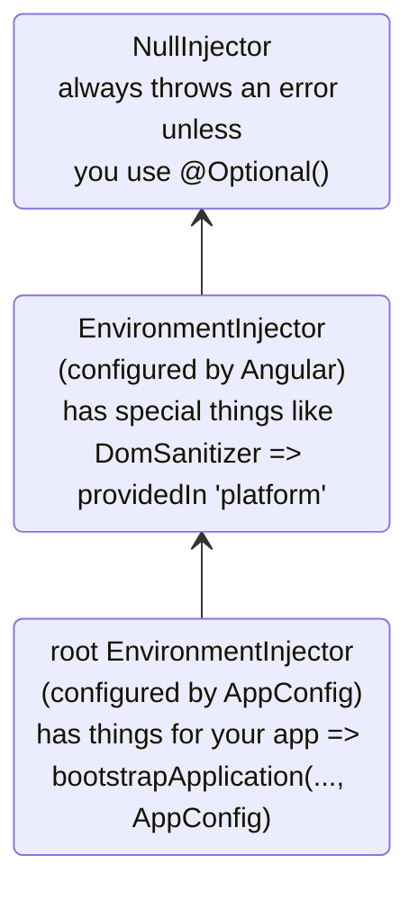
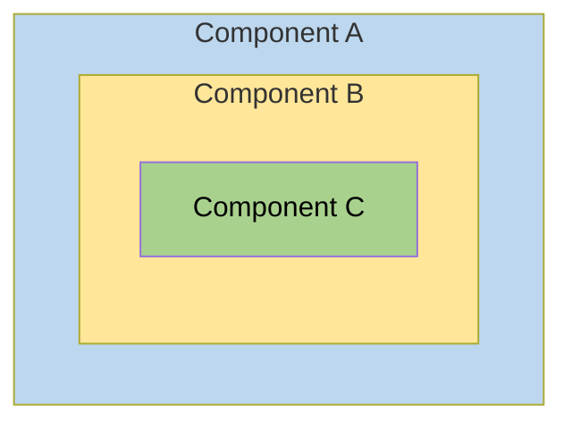
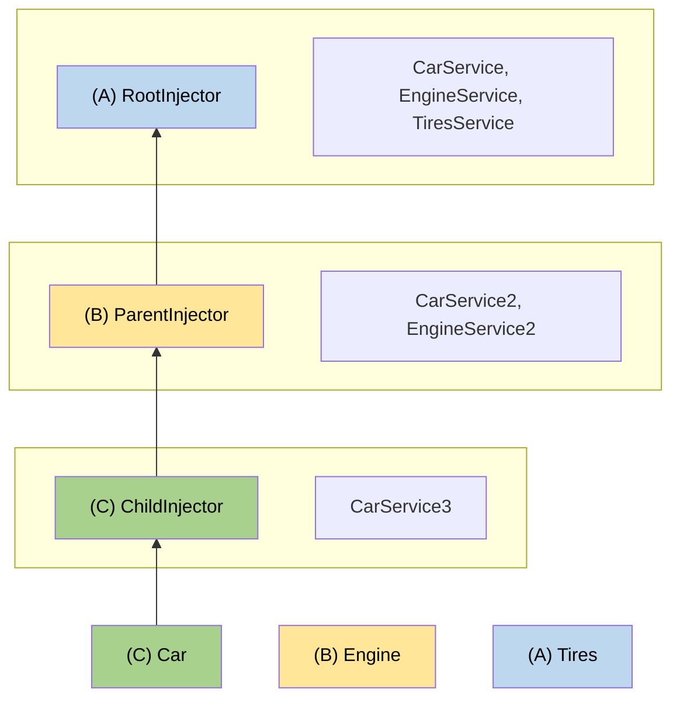

<!-- source: 6fe64ebf2ace04dc26856dd7743e3e491cbdaf74 -->
# Injectors hiérarchiques

Ce guide couvre en profondeur le système hiérarchique d'injection de dépendances d'Angular, y compris les règles de résolution, les modificateurs et les patterns avancés.

NOTE: Pour les concepts de base sur la hiérarchie des injectors et la portée des providers, consultez le [guide sur la définition des providers de dépendances](guide/di/defining-dependency-providers#injector-hierarchy-in-angular).

## Types de hiérarchies d'injectors {#types-of-injector-hierarchies}

Angular possède deux hiérarchies d'injectors :

| Hiérarchies d'injectors         | Détails                                                                                                                                                                   |
| :------------------------------ | :------------------------------------------------------------------------------------------------------------------------------------------------------------------------ |
| Hiérarchie `EnvironmentInjector` | Configurez un `EnvironmentInjector` dans cette hiérarchie avec `@Service()` ou le tableau `providers` de `ApplicationConfig`.                                           |
| Hiérarchie `ElementInjector`     | Créée implicitement pour chaque élément du DOM. Un `ElementInjector` est vide par défaut, sauf si vous le configurez dans la propriété `providers` de `@Directive()` ou `@Component()`. |

<docs-callout title="Applications basées sur NgModule">
Pour les applications basées sur `NgModule`, vous pouvez fournir des dépendances avec la hiérarchie `ModuleInjector` à l'aide d'une annotation `@NgModule()` ou `@Injectable()`.
</docs-callout>

### `EnvironmentInjector` {#environmentinjector}

L'`EnvironmentInjector` peut être configuré de deux façons, en utilisant :

- Le décorateur `@Service()`
- Le tableau `providers` de `ApplicationConfig`

<docs-callout title="Tree-shaking et @Service()">

Il est préférable d'utiliser le décorateur `@Service()` plutôt que le tableau `providers` de `ApplicationConfig`. Avec `@Service`, les outils d'optimisation peuvent effectuer du tree-shaking, qui supprime les services que votre application n'utilise pas. Cela réduit la taille des bundles.

Le tree-shaking est particulièrement utile pour une library, car l'application qui utilise la library n'a pas forcément besoin de l'injecter.

</docs-callout>

L'`EnvironmentInjector` est configuré par `ApplicationConfig.providers`.

Fournissez des services avec `@Service()` de la façon suivante :

```ts {highlight:[4]}
import {Service} from '@angular/core';

@Service() // <--provides this service in the root EnvironmentInjector
export class ItemService {
  name = 'telephone';
}
```

Les décorateurs `@Service()` ou `@Injectable()` identifient une classe de service.

### ModuleInjector {#moduleinjector}

Dans le cas des applications basées sur `NgModule`, le ModuleInjector peut être configuré de deux façons, en utilisant :

- Le décorateur `@Service()`,
- La propriété `providedIn` de `@Injectable()` pour faire référence à `root` ou `platform`
- Le tableau `providers` de `@NgModule()`

Le `ModuleInjector` est configuré par les propriétés `@NgModule.providers` et `NgModule.imports`. Le `ModuleInjector` est l'aplatissement de tous les tableaux de providers accessibles en suivant récursivement `NgModule.imports`.

Des hiérarchies `ModuleInjector` enfants sont créées lors du lazy loading d'autres `@NgModules`.

### Injector de plateforme {#platform-injector}

Il existe deux autres injectors au-dessus de `root` : un `EnvironmentInjector` supplémentaire et le `NullInjector()`.

Voyez comment Angular effectue le bootstrap de l'application avec le code suivant dans `main.ts` :

```ts
bootstrapApplication(App, appConfig);
```

La méthode `bootstrapApplication()` crée un injector enfant de l'injector de plateforme, configuré par l'instance de `ApplicationConfig`.
Il s'agit de l'`EnvironmentInjector` `root`.

La méthode `bootstrapApplication()` crée également (ou réutilise) l'injector de plateforme, qui contient les dépendances propres à la plateforme.
Cela permet à plusieurs applications de partager une configuration de plateforme.
Par exemple, un navigateur n'a qu'une seule barre d'adresse, quel que soit le nombre d'applications en cours d'exécution.
Vous pouvez configurer des providers supplémentaires propres à la plateforme au niveau de la plateforme en fournissant `extraProviders` via la fonction `platformBrowser()`.

L'injector parent suivant dans la hiérarchie est le `NullInjector()`, qui est le sommet de l'arbre.
Si vous êtes remonté si haut dans l'arbre que vous cherchez un service dans le `NullInjector()`, vous obtiendrez une erreur, sauf si vous avez utilisé `@Optional()`, car au bout du compte, tout se termine au `NullInjector()`, qui renvoie une erreur ou, dans le cas de `@Optional()`, `null`.
Pour plus d'informations sur `@Optional()`, consultez la [section `@Optional()`](#optional) de ce guide.

Le diagramme suivant représente la relation entre le `ModuleInjector` `root` et ses injectors parents, telle que décrite dans les paragraphes précédents.



Si le nom `root` est un alias spécial, les autres hiérarchies `EnvironmentInjector` n'ont pas d'alias.
Vous avez la possibilité de créer des hiérarchies `EnvironmentInjector` chaque fois qu'un composant chargé dynamiquement est créé, par exemple avec le Router, qui crée des hiérarchies `EnvironmentInjector` enfants.

Toutes les requêtes remontent jusqu'à l'injector racine, que vous l'ayez configuré avec l'instance de `ApplicationConfig` passée à la méthode `bootstrapApplication()` ou que vous ayez enregistré tous les providers avec `root` dans leurs propres services.

<docs-callout title="@Injectable() ou ApplicationConfig">

Si vous configurez un provider à l'échelle de l'application dans l'`ApplicationConfig` de `bootstrapApplication`, il remplace celui configuré pour `root` dans les métadonnées de `@Injectable()`.
Vous pouvez le faire pour configurer un provider autre que celui par défaut pour un service partagé entre plusieurs applications.

Voici un exemple où la configuration du router de composants inclut une [location strategy](guide/routing/common-router-tasks#locationstrategy-and-browser-url-styles) autre que celle par défaut, en listant son provider dans la liste `providers` de l'`ApplicationConfig`.

```ts
providers: [{provide: LocationStrategy, useClass: HashLocationStrategy}];
```

Pour les applications basées sur `NgModule`, configurez les providers à l'échelle de l'application dans les `providers` de l'`AppModule`.

</docs-callout>

### `ElementInjector` {#elementinjector}

Angular crée implicitement des hiérarchies `ElementInjector` pour chaque élément du DOM.

Fournir un service dans le décorateur `@Component()` via sa propriété `providers` ou `viewProviders` configure un `ElementInjector`.
Par exemple, le `TestComponent` suivant configure l'`ElementInjector` en fournissant le service comme suit :

```ts {highlight:[3]}
@Component({
  /* … */
  providers: [{ provide: ItemService, useValue: { name: 'lamp' } }]
})
export class TestComponent
```

HELPFUL: Consultez la section [règles de résolution](#resolution-rules) pour comprendre la relation entre l'arbre `EnvironmentInjector`, le `ModuleInjector` et l'arbre `ElementInjector`.

Lorsque vous fournissez des services dans un composant, ce service est disponible via l'`ElementInjector` de cette instance du composant.
Il peut aussi être visible dans les composants et directives enfants, selon les règles de visibilité décrites dans la section [règles de résolution](#resolution-rules).

Lorsque l'instance du composant est détruite, l'instance du service l'est aussi.

#### `@Directive()` et `@Component()` {#directive-and-component}

Un composant est un type particulier de directive, ce qui signifie que, tout comme `@Directive()` possède une propriété `providers`, `@Component()` en possède une aussi.
Cela signifie que les directives comme les composants peuvent configurer des providers, avec la propriété `providers`.
Lorsque vous configurez un provider pour un composant ou une directive avec la propriété `providers`, ce provider appartient à l'`ElementInjector` de ce composant ou de cette directive.
Les composants et directives présents sur le même élément partagent un injector.

## Règles de résolution {#resolution-rules}

Pour résoudre un jeton pour un composant ou une directive, Angular procède en deux phases :

1. Auprès de ses parents dans la hiérarchie `ElementInjector`.
2. Auprès de ses parents dans la hiérarchie `EnvironmentInjector`.

Lorsqu'un composant déclare une dépendance, Angular essaie de la satisfaire avec son propre `ElementInjector`.
Si l'injector du composant n'a pas le provider, il transmet la requête à l'`ElementInjector` de son composant parent.

Les requêtes continuent de remonter jusqu'à ce qu'Angular trouve un injector capable de les traiter ou qu'il n'y ait plus de hiérarchies `ElementInjector` ancêtres.

Si Angular ne trouve le provider dans aucune hiérarchie `ElementInjector`, il revient à l'élément d'où provient la requête et cherche dans la hiérarchie `EnvironmentInjector`.
Si Angular ne trouve toujours pas le provider, il lève une erreur.

Si vous avez enregistré un provider pour le même jeton de DI à différents niveaux, Angular utilise le premier qu'il rencontre pour résoudre la dépendance.
Si, par exemple, un provider est enregistré localement dans le composant qui a besoin d'un service,
Angular ne cherche pas d'autre provider pour ce même service.

HELPFUL: Pour les applications basées sur `NgModule`, Angular cherche dans la hiérarchie `ModuleInjector` s'il ne trouve pas de provider dans les hiérarchies `ElementInjector`.

## Modificateurs de résolution {#resolution-modifiers}

Le comportement de résolution d'Angular peut être modifié avec `optional`, `self`, `skipSelf` et `host`.
Importez chacun d'eux depuis `@angular/core` et utilisez-les dans la configuration de [`inject`](/api/core/inject) lorsque vous injectez votre service.

### Types de modificateurs {#types-of-modifiers}

Les modificateurs de résolution se répartissent en trois catégories :

- Que faire si Angular ne trouve pas ce que vous cherchez : c'est `optional`
- Où commencer la recherche : c'est `skipSelf`
- Où arrêter la recherche : `host` et `self`

Par défaut, Angular commence toujours par l'`Injector` courant et poursuit la recherche jusqu'en haut.
Les modificateurs vous permettent de changer l'emplacement de départ, ou _self_, et l'emplacement d'arrivée.

De plus, vous pouvez combiner tous les modificateurs, sauf :

- `host` et `self`
- `skipSelf` et `self`.

### `optional` {#optional}

`optional` permet à Angular de considérer un service que vous injectez comme optionnel.
Ainsi, s'il ne peut pas être résolu à l'exécution, Angular résout le service à `null` au lieu de lever une erreur.
Dans l'exemple suivant, le service `OptionalService` n'est fourni ni dans le service, ni dans `ApplicationConfig`, ni dans un `@NgModule()`, ni dans la classe du composant ; il n'est donc disponible nulle part dans l'application.

```ts {header:"src/app/optional/optional.ts"}
export class Optional {
  public optional? = inject(OptionalService, {optional: true});
}
```

### `self` {#self}

Utilisez `self` pour qu'Angular ne consulte que l'`ElementInjector` du composant ou de la directive courant.

Un bon cas d'usage de `self` consiste à injecter un service uniquement s'il est disponible sur le host element courant.
Pour éviter les erreurs dans cette situation, combinez `self` avec `optional`.

Par exemple, dans le `SelfNoData` suivant, remarquez le `LeafService` injecté en tant que propriété.

```ts {header: 'self-no-data.ts', highlight: [7]}
@Component({
  selector: 'app-self-no-data',
  templateUrl: './self-no-data.html',
  styleUrls: ['./self-no-data.css'],
})
export class SelfNoData {
  public leaf = inject(LeafService, {optional: true, self: true});
}
```

Dans cet exemple, il existe un provider parent et injecter le service renverrait sa valeur ; cependant, injecter le service avec `self` et `optional` renvoie `null`, car `self` indique à l'injector d'arrêter sa recherche au host element courant.

Un autre exemple montre la classe du composant avec un provider pour `FlowerService`.
Dans ce cas, l'injector ne cherche pas au-delà de l'`ElementInjector` courant, car il y trouve le `FlowerService` et renvoie la tulipe 🌷.

```ts {header:"src/app/self/self.ts"}
@Component({
  selector: 'app-self',
  templateUrl: './self.html',
  styleUrls: ['./self.css'],
  providers: [{provide: FlowerService, useValue: {emoji: '🌷'}}],
})
export class Self {
  public flower = inject(FlowerService, {self: true});
}
```

### `skipSelf` {#skipself}

`skipSelf` est l'inverse de `self`.
Avec `skipSelf`, Angular commence sa recherche d'un service dans l'`ElementInjector` parent, plutôt que dans l'injector courant.
Ainsi, si l'`ElementInjector` parent utilisait la valeur fougère <code>🌿</code> pour `emoji`, mais que vous aviez la feuille d'érable <code>🍁</code> dans le tableau `providers` du composant, Angular ignorerait la feuille d'érable <code>🍁</code> et utiliserait la fougère <code>🌿</code>.

Pour le voir dans le code, supposez que la valeur suivante pour `emoji` soit celle qu'utilisait le composant parent, comme dans ce service :

```ts {header: 'leaf.service.ts'}
export class LeafService {
  emoji = '🌿';
}
```

Imaginez que dans le composant enfant, vous ayez une valeur différente, la feuille d'érable 🍁, mais que vous vouliez utiliser la valeur du parent à la place.
C'est là que vous utiliseriez `skipSelf` :

```ts {header:"skipself.ts" highlight:[[6],[10]]}
@Component({
  selector: 'app-skipself',
  templateUrl: './skipself.html',
  styleUrls: ['./skipself.css'],
  // Angular would ignore this LeafService instance
  providers: [{provide: LeafService, useValue: {emoji: '🍁'}}],
})
export class Skipself {
  // Use skipSelf as inject option
  public leaf = inject(LeafService, {skipSelf: true});
}
```

Dans ce cas, la valeur obtenue pour `emoji` serait la fougère <code>🌿</code>, et non la feuille d'érable <code>🍁</code>.

#### Option `skipSelf` avec `optional` {#skipself-option-with-optional}

Utilisez l'option `skipSelf` avec `optional` pour éviter une erreur si la valeur est `null`.

Dans l'exemple suivant, le service `Person` est injecté lors de l'initialisation de la propriété.
`skipSelf` indique à Angular d'ignorer l'injector courant, et `optional` évite une erreur si le service `Person` était `null`.

```ts
class Person {
  parent = inject(Person, {optional: true, skipSelf: true});
}
```

### `host` {#host}

<!-- TODO: Remove ambiguity between host and self. -->

`host` vous permet de désigner un composant comme dernier arrêt dans l'arbre des injectors lors de la recherche de providers.

Même s'il existe une instance du service plus haut dans l'arbre, Angular ne poursuit pas la recherche.
Utilisez `host` comme suit :

```ts {header:"host.ts" highlight:[[6],[9]]}
@Component({
  selector: 'app-host',
  templateUrl: './host.html',
  styleUrls: ['./host.css'],
  // provide the service
  providers: [{provide: FlowerService, useValue: {emoji: '🌷'}}],
})
export class Host {
  // use host when injecting the service
  flower = inject(FlowerService, {host: true, optional: true});
}
```

Comme `Host` utilise l'option `host`, quelle que soit la valeur de `flower.emoji` dont dispose le parent de `Host`, `Host` utilisera la tulipe <code>🌷</code>.

### Modificateurs avec l'injection par constructeur {#modifiers-with-constructor-injection}

De la même manière que précédemment, le comportement de l'injection par constructeur peut être modifié avec `@Optional()`, `@Self()`, `@SkipSelf()` et `@Host()`.

Importez chacun d'eux depuis `@angular/core` et utilisez-les dans le constructeur de la classe du composant lorsque vous injectez votre service.

```ts {header:"self-no-data.ts" highlight:[2]}
export class SelfNoData {
  constructor(@Self() @Optional() public leaf?: LeafService) {}
}
```

## Structure logique du template {#logical-structure-of-the-template}

Lorsque vous fournissez des services dans la classe du composant, ces services sont visibles dans l'arbre `ElementInjector` en fonction de l'endroit et de la manière dont vous les fournissez.

Comprendre la structure logique sous-jacente du template Angular vous donne les bases pour configurer les services et, par conséquent, contrôler leur visibilité.

Les composants sont utilisés dans vos templates, comme dans l'exemple suivant :

```html
<app-root> <app-child />; </app-root>
```

HELPFUL: En général, vous déclarez les composants et leurs templates dans des fichiers séparés.
Pour comprendre le fonctionnement du système d'injection, il est utile de les considérer du point de vue d'un arbre logique combiné.
Le terme _logique_ le distingue de l'arbre de rendu, qui est l'arbre DOM de votre application.
Pour indiquer l'emplacement des templates des composants, ce guide utilise le pseudo-élément `<#VIEW>`, qui n'existe pas réellement dans l'arbre de rendu et ne sert qu'à construire un modèle mental.

Voici un exemple de la façon dont les arbres de vues de `<app-root>` et `<app-child>` sont combinés en un seul arbre logique :

```html
<app-root>
  <#VIEW>
    <app-child>
     <#VIEW>
       …content goes here…
     </#VIEW>
    </app-child>
  </#VIEW>
</app-root>
```

Comprendre l'idée de la démarcation `<#VIEW>` est particulièrement important lorsque vous configurez des services dans la classe du composant.

## Exemple : fournir des services dans `@Component()` {#example-providing-services-in-component}

La façon dont vous fournissez des services avec un décorateur `@Component()` (ou `@Directive()`) détermine leur visibilité.
Les sections suivantes présentent `providers` et `viewProviders`, ainsi que les façons de modifier la visibilité des services avec `skipSelf` et `host`.

Une classe de composant peut fournir des services de deux façons :

| Tableaux                         | Détails                                        |
| :--------------------------- | :--------------------------------------------- |
| Avec un tableau `providers`      | `@Component({ providers: [SomeService] })`     |
| Avec un tableau `viewProviders`  | `@Component({ viewProviders: [SomeService] })` |

Dans les exemples ci-dessous, vous verrez l'arbre logique d'une application Angular.
Pour illustrer le fonctionnement de l'injector dans le contexte des templates, l'arbre logique représente la structure HTML de l'application.
Par exemple, l'arbre logique montrera que `<child-component>` est un enfant direct de `<parent-component>`.

Dans l'arbre logique, vous verrez des attributs spéciaux : `@Provide`, `@Inject` et `@ApplicationConfig`.
Ce ne sont pas de vrais attributs : ils servent à montrer ce qui se passe en coulisses.

| Attribut de service Angular | Détails                                                                                  |
| :------------------------ | :--------------------------------------------------------------------------------------- |
| `@Inject(Token)=>Value`   | Si `Token` est injecté à cet emplacement de l'arbre logique, sa valeur serait `Value`. |
| `@Provide(Token=Value)`   | Indique que `Token` est fourni avec `Value` à cet emplacement de l'arbre logique.    |
| `@ApplicationConfig`      | Indique qu'un `EnvironmentInjector` de repli doit être utilisé à cet emplacement.      |

### Structure de l'application d'exemple {#example-app-structure}

L'application d'exemple possède un `FlowerService` fourni dans `root` avec une valeur `emoji` d'hibiscus rouge <code>🌺</code>.

```ts {header:"flower.service.ts"}
@Service()
export class FlowerService {
  emoji = '🌺';
}
```

Prenons une application composée uniquement d'un `App` et d'un `Child`.
La vue rendue la plus simple ressemblerait à des éléments HTML imbriqués comme ceux-ci :

```html
<app-root>
  <!-- App selector -->
  <app-child> <!-- Child selector --> </app-child>
</app-root>
```

Cependant, en coulisses, Angular utilise une représentation logique des vues comme suit pour résoudre les requêtes d'injection :

```html
<app-root> <!-- App selector -->
  <#VIEW>
    <app-child> <!-- Child selector -->
      <#VIEW>
      </#VIEW>
    </app-child>
  </#VIEW>
</app-root>
```

Le `<#VIEW>` représente ici une instance d'un template.
Remarquez que chaque composant possède son propre `<#VIEW>`.

Connaître cette structure vous aide à décider comment fournir et injecter vos services, et vous donne un contrôle total sur leur visibilité.

Supposons maintenant que `<app-root>` injecte le `FlowerService` :

```typescript
export class App {
  flower = inject(FlowerService);
}
```

Ajoutez un binding au template de `<app-root>` pour visualiser le résultat :

```html
<p>Emoji from FlowerService: {{flower.emoji}}</p>
```

Le résultat affiché dans la vue serait :

```text {hideCopy}
Emoji from FlowerService: 🌺
```

Dans l'arbre logique, cela serait représenté comme suit :

```html
<app-root @ApplicationConfig
        @Inject(FlowerService) flower=>"🌺">
  <#VIEW>
    <p>Emoji from FlowerService: {{flower.emoji}} (🌺)</p>
    <app-child>
      <#VIEW>
      </#VIEW>
    </app-child>
  </#VIEW>
</app-root>
```

Lorsque `<app-root>` demande le `FlowerService`, c'est à l'injector de résoudre le jeton `FlowerService`.
La résolution du jeton se fait en deux phases :

1. L'injector détermine l'emplacement de départ dans l'arbre logique et l'emplacement d'arrivée de la recherche.
   L'injector commence à l'emplacement de départ et cherche le jeton à chaque niveau de vue de l'arbre logique.
   Si le jeton est trouvé, il est renvoyé.

1. Si le jeton n'est pas trouvé, l'injector cherche l'`EnvironmentInjector` parent le plus proche auquel déléguer la requête.

Dans cet exemple, les contraintes sont les suivantes :

1. Commencer par le `<#VIEW>` appartenant à `<app-root>` et terminer par `<app-root>`.
   - Normalement, le point de départ de la recherche est le point d'injection.
     Cependant, ici `<app-root>` est un composant. Les `@Component` sont particuliers, car ils incluent aussi leurs propres `viewProviders` ; c'est pourquoi la recherche commence au `<#VIEW>` appartenant à `<app-root>`.
     Ce ne serait pas le cas pour une directive correspondant au même emplacement.
   - L'emplacement d'arrivée se trouve être le composant lui-même, car c'est le composant le plus haut de cette application.

1. L'`EnvironmentInjector` fourni par l'`ApplicationConfig` sert d'injector de repli lorsque le jeton d'injection est introuvable dans les hiérarchies `ElementInjector`.

### Utiliser le tableau `providers` {#using-the-providers-array}

Maintenant, dans la classe `Child`, ajoutez un provider pour `FlowerService` afin d'illustrer des règles de résolution plus complexes dans les sections suivantes :

```ts
@Component({
  selector: 'app-child',
  templateUrl: './child.html',
  styleUrls: ['./child.css'],
  // use the providers array to provide a service
  providers: [{provide: FlowerService, useValue: {emoji: '🌻'}}],
})
export class Child {
  // inject the service
  flower = inject(FlowerService);
}
```

Maintenant que le `FlowerService` est fourni dans le décorateur `@Component()`, lorsque `<app-child>` demande le service, l'injector n'a besoin de chercher que jusqu'à l'`ElementInjector` de `<app-child>`.
Il n'a pas besoin de poursuivre la recherche plus loin dans l'arbre des injectors.

L'étape suivante consiste à ajouter un binding au template de `Child`.

```html
<p>Emoji from FlowerService: {{flower.emoji}}</p>
```

Pour afficher les nouvelles valeurs, ajoutez `<app-child>` en bas du template de `App` afin que la vue affiche aussi le tournesol :

```text {hideCopy}
Child Component
Emoji from FlowerService: 🌻
```

Dans l'arbre logique, cela est représenté comme suit :

```html
<app-root @ApplicationConfig
          @Inject(FlowerService) flower=>"🌺">
  <#VIEW>

  <p>Emoji from FlowerService: {{flower.emoji}} (🌺)</p>
  <app-child @Provide(FlowerService="🌻" )
             @Inject(FlowerService)=>"🌻"> <!-- search ends here -->
    <#VIEW> <!-- search starts here -->
    <h2>Child Component</h2>
    <p>Emoji from FlowerService: {{flower.emoji}} (🌻)</p>
  </
  #VIEW>
  </app-child>
</#VIEW>
</app-root>
```

Lorsque `<app-child>` demande le `FlowerService`, l'injector commence sa recherche au `<#VIEW>` appartenant à `<app-child>` \(le `<#VIEW>` est inclus parce que l'injection se fait depuis `@Component()`\) et la termine à `<app-child>`.
Dans ce cas, le `FlowerService` est résolu dans le tableau `providers` de `<app-child>`, avec le tournesol <code>🌻</code>.
L'injector n'a pas besoin de chercher plus loin dans l'arbre des injectors.
Il s'arrête dès qu'il trouve le `FlowerService` et ne voit jamais l'hibiscus rouge <code>🌺</code>.

### Utiliser le tableau `viewProviders` {#using-the-viewproviders-array}

Utilisez le tableau `viewProviders` comme autre moyen de fournir des services dans le décorateur `@Component()`.
Utiliser `viewProviders` rend les services visibles dans le `<#VIEW>`.

HELPFUL: Les étapes sont les mêmes qu'avec le tableau `providers`, à ceci près que vous utilisez le tableau `viewProviders` à la place.

Pour des instructions pas à pas, poursuivez avec cette section.
Si vous savez le mettre en place vous-même, passez directement à [Modifier la disponibilité des services](#visibility-of-provided-tokens).

Pour la démonstration, nous créons un `AnimalService` afin d'illustrer `viewProviders`.
Commencez par créer un `AnimalService` avec une propriété `emoji` valant la baleine <code>🐳</code> :

```typescript
import {Service} from '@angular/core';

@Service()
export class AnimalService {
  emoji = '🐳';
}
```

En suivant le même pattern qu'avec le `FlowerService`, injectez l'`AnimalService` dans la classe `App` :

```ts
export class App {
  public flower = inject(FlowerService);
  public animal = inject(AnimalService);
}
```

HELPFUL: Vous pouvez laisser en place tout le code lié au `FlowerService`, car il permettra une comparaison avec l'`AnimalService`.

Ajoutez un tableau `viewProviders` et injectez aussi l'`AnimalService` dans la classe de `<app-child>`, mais donnez à `emoji` une valeur différente.
Ici, sa valeur est le chien 🐶.

```typescript
@Component({
  selector: 'app-child',
  templateUrl: './child.html',
  styleUrls: ['./child.css'],
  // provide services
  providers: [{provide: FlowerService, useValue: {emoji: '🌻'}}],
  viewProviders: [{provide: AnimalService, useValue: {emoji: '🐶'}}],
})
export class Child {
  // inject services
  flower = inject(FlowerService);
  animal = inject(AnimalService);
}
```

Ajoutez des bindings aux templates de `Child` et de `App`.
Dans le template de `Child`, ajoutez le binding suivant :

```html
<p>Emoji from AnimalService: {{animal.emoji}}</p>
```

Ajoutez également le même binding au template de `App` :

```html
<p>Emoji from AnimalService: {{animal.emoji}}</p>
```

Vous devriez maintenant voir les deux valeurs dans le navigateur :

```text {hideCopy}
App
Emoji from AnimalService: 🐳

Child Component
Emoji from AnimalService: 🐶
```

L'arbre logique de cet exemple avec `viewProviders` est le suivant :

```html
<app-root @ApplicationConfig
          @Inject(AnimalService) animal=>"🐳">
  <#VIEW>
  <app-child>
    <#VIEW @Provide(AnimalService="🐶")
    @Inject(AnimalService=>"🐶")>

    <!-- ^^using viewProviders means AnimalService is available in <#VIEW>-->
    <p>Emoji from AnimalService: {{animal.emoji}} (🐶)</p>
  </
  #VIEW>
  </app-child>
</#VIEW>
</app-root>
```

Comme dans l'exemple du `FlowerService`, l'`AnimalService` est fourni dans le décorateur `@Component()` de `<app-child>`.
Cela signifie que, puisque l'injector cherche d'abord dans l'`ElementInjector` du composant, il trouve la valeur chien <code>🐶</code> de l'`AnimalService`.
Il n'a pas besoin de poursuivre la recherche dans l'arbre `ElementInjector`, ni de chercher dans le `ModuleInjector`.

### `providers` ou `viewProviders` {#providers-vs-viewproviders}

Le champ `viewProviders` est conceptuellement similaire à `providers`, mais il existe une différence notable.
Les providers de `viewProviders` ne sont visibles que dans la propre vue du composant : le contenu projeté dans le composant via `<ng-content>` ne peut pas les voir.

Pour voir la différence entre `providers` et `viewProviders`, ajoutez un autre composant à l'exemple et appelez-le `Inspector`.
`Inspector` sera un enfant de `Child`.
Dans `inspector.ts`, injectez le `FlowerService` et l'`AnimalService` lors de l'initialisation des propriétés :

```typescript
export class Inspector {
  flower = inject(FlowerService);
  animal = inject(AnimalService);
}
```

Vous n'avez pas besoin de tableau `providers` ni `viewProviders`.
Ensuite, dans `inspector.html`, ajoutez le même balisage que dans les composants précédents :

```html
<p>Emoji from FlowerService: {{flower.emoji}}</p>
<p>Emoji from AnimalService: {{animal.emoji}}</p>
```

N'oubliez pas d'ajouter `Inspector` au tableau `imports` de `Child`.

```ts
@Component({
  ...
  imports: [Inspector]
})
```

Ensuite, ajoutez le code suivant à `child.html` :

```html
...

<div class="container">
  <h3>Content projection</h3>
  <ng-content />
</div>
<h3>Inside the view</h3>

<app-inspector />
```

`<ng-content>` vous permet de projeter du contenu, et `<app-inspector>` dans le template de `Child` fait d'`Inspector` un composant enfant de `Child`.

Ensuite, ajoutez le code suivant à `app.html` pour tirer parti de la projection de contenu.

```html
<app-child>
  <app-inspector />
</app-child>
```

Le navigateur affiche maintenant ce qui suit (les exemples précédents sont omis par souci de concision) :

```text {hideCopy}
...
Content projection

Emoji from FlowerService: 🌻
Emoji from AnimalService: 🐳

Emoji from FlowerService: 🌻
Emoji from AnimalService: 🐶
```

Ces quatre bindings montrent la différence entre `providers` et `viewProviders`.
Rappelez-vous que l'emoji chien <code>🐶</code> est déclaré dans le `<#VIEW>` de `Child` et n'est pas visible par le contenu projeté.
Le contenu projeté voit à la place la baleine <code>🐳</code>.

Vous vous demandez peut-être pourquoi le `<app-inspector>` projeté peut tout de même voir <code>🐳</code>, c'est-à-dire l'`AnimalService` fourni à la racine.
La raison est que la DI d'Angular suit **l'endroit où un composant a été déclaré**, et non l'endroit où il finit par être rendu.
`<app-inspector>` se trouve dans le template de `App`, à l'intérieur du `<#VIEW>` de `App` ; sa recherche ne passe donc jamais par le `<#VIEW>` de `Child`.
Le projeter dans `Child` lui coupe l'accès aux `viewProviders` de `Child` (<code>🐶</code>), mais l'`AnimalService` racine (<code>🐳</code>) reste accessible en remontant l'arbre.

En revanche, dans la sortie suivante, l'`Inspector` est un véritable composant enfant de `Child` : `Inspector` se trouve dans le `<#VIEW>`, donc lorsqu'il demande l'`AnimalService`, il voit le chien <code>🐶</code>.

L'`AnimalService` dans l'arbre logique ressemblerait à ceci :

```html
<app-root @ApplicationConfig
          @Inject(AnimalService) animal=>"🐳">
  <#VIEW>
  <app-child>
    <#VIEW @Provide(AnimalService="🐶")
    @Inject(AnimalService=>"🐶")>

    <!-- ^^using viewProviders means AnimalService is available in <#VIEW>-->
    <p>Emoji from AnimalService: {{animal.emoji}} (🐶)</p>

    <div class="container">
      <h3>Content projection</h3>
      <app-inspector @Inject(AnimalService) animal=>"🐳">
        <p>Emoji from AnimalService: {{animal.emoji}} (🐳)</p>
      </app-inspector>
    </div>

    <app-inspector>
      <#VIEW @Inject(AnimalService) animal=>"🐶">
      <p>Emoji from AnimalService: {{animal.emoji}} (🐶)</p>
    </
    #VIEW>
    </app-inspector>
  </
  #VIEW>
  </app-child>

</#VIEW>
</app-root>
```

Le `<app-inspector>` projeté obtient <code>🐳</code>, car <code>🐶</code> appartient à la vue de `Child` et le contenu projeté ne peut pas l'atteindre.
<code>🐳</code> est accessible parce que `<app-inspector>` a été déclaré dans le template de `App` ; il peut donc encore remonter jusqu'à l'`AnimalService` racine.

Le `<app-inspector>` qui se trouve directement dans le template de `Child` (non projeté) obtient <code>🐶</code> : il est à l'intérieur du `<#VIEW>`, il n'y a donc aucune frontière à franchir.

### Donner au contenu projeté l'accès à un injector de vue {#giving-projected-content-access-to-a-view-injector}

Le contenu projeté avec `<ng-content>` ne peut pas voir les `viewProviders` d'un composant, car Angular résout l'injection auprès de l'injector où le contenu est déclaré, et non là où il est rendu.

Lorsque vous voulez précisément que le contenu projeté atteigne un service au niveau de la vue (ou l'instance du composant qui projette elle-même), acceptez le contenu sous forme de template au lieu de `<ng-content>` et rendez-le avec un injector explicite.

Modifiez `Child` pour fournir `AnimalService` dans `viewProviders`, récupérer le template projeté avec une query et le rendre via [`NgTemplateOutlet`](/api/common/NgTemplateOutlet), avec `ngTemplateOutletInjector` défini sur un injector qui peut voir ce service :

```ts
@Component({
  selector: 'app-child',
  viewProviders: [AnimalService],
  imports: [NgTemplateOutlet],
  template: `
    <ng-container [ngTemplateOutlet]="content()" [ngTemplateOutletInjector]="injector" />
  `,
})
export class Child {
  readonly content = contentChild.required(TemplateRef);
  readonly injector = inject(Injector);
}
```

Le consommateur enveloppe le balisage projeté dans un `<ng-template>` :

```html
<app-child>
  <ng-template>
    <app-inspector />
  </ng-template>
</app-child>
```

`Child` crée maintenant `<app-inspector>` au niveau de l'outlet avec son propre injector ; `AnimalService` se résout donc en chien <code>🐶</code>, même si le balisage est écrit dans le template de `App`. Le coût est un peu de balisage supplémentaire des deux côtés par rapport à `<ng-content>`.

### Visibilité des jetons fournis {#visibility-of-provided-tokens}

Les décorateurs de visibilité influencent l'endroit où la recherche du jeton d'injection commence et se termine dans l'arbre logique.
Pour cela, placez la configuration de visibilité au point d'injection, c'est-à-dire lors de l'appel à `inject()`, plutôt qu'au point de déclaration.

Pour modifier l'endroit où l'injector commence à chercher `FlowerService`, ajoutez `skipSelf` à l'appel `inject()` de `<app-child>` où `FlowerService` est injecté.
Cet appel est un initialiseur de propriété dans `<app-child>`, comme le montre `child.ts` :

```typescript
flower = inject(FlowerService, {skipSelf: true});
```

Avec `skipSelf`, l'injector de `<app-child>` ne cherche pas le `FlowerService` en lui-même.
L'injector commence plutôt à chercher le `FlowerService` dans l'`ElementInjector` de `<app-root>`, où il ne trouve rien.
Il revient ensuite au `ModuleInjector` de `<app-child>` et trouve la valeur hibiscus rouge <code>🌺</code>, disponible parce que `<app-child>` et `<app-root>` partagent le même `ModuleInjector`.
L'interface affiche ce qui suit :

```text {hideCopy}
Emoji from FlowerService: 🌺
```

Dans un arbre logique, cette même idée pourrait ressembler à ceci :

```html
<app-root @ApplicationConfig
          @Inject(FlowerService) flower=>"🌺">
  <#VIEW>
  <app-child @Provide(FlowerService="🌻" )>
    <#VIEW @Inject(FlowerService, SkipSelf)=>"🌺">

    <!-- With SkipSelf, the injector looks to the next injector up the tree (app-root) -->

  </
  #VIEW>
  </app-child>
</#VIEW>
</app-root>
```

Bien que `<app-child>` fournisse le tournesol <code>🌻</code>, l'application affiche l'hibiscus rouge <code>🌺</code>, car `skipSelf` amène l'injector courant (`app-child`) à s'ignorer lui-même et à chercher dans son parent.

Si vous ajoutez maintenant `host` (en plus de `skipSelf`), le résultat sera `null`.
En effet, `host` limite la borne supérieure de la recherche au `<#VIEW>` de `app-child`.
Voici l'idée dans l'arbre logique :

```html
<app-root @ApplicationConfig
          @Inject(FlowerService) flower=>"🌺">
  <#VIEW> <!-- end search here with null-->
  <app-child @Provide(FlowerService="🌻" )> <!-- start search here -->
    <#VIEW inject(FlowerService, {skipSelf: true, host: true, optional:true})=>null>
  </
  #VIEW>
  </app-parent>
</#VIEW>
</app-root>
```

Ici, les services et leurs valeurs sont les mêmes, mais `host` empêche l'injector de chercher `FlowerService` au-delà du `<#VIEW>` ; il ne le trouve donc pas et renvoie `null`.

### `skipSelf` et `viewProviders` {#skipself-and-viewproviders}

Rappelez-vous que `<app-child>` fournit l'`AnimalService` dans le tableau `viewProviders` avec la valeur chien <code>🐶</code>.
Comme l'injector n'a qu'à consulter l'`ElementInjector` de `<app-child>` pour trouver l'`AnimalService`, il ne voit jamais la baleine <code>🐳</code>.

Comme dans l'exemple du `FlowerService`, si vous ajoutez `skipSelf` à l'appel `inject()` de l'`AnimalService`, l'injector ne cherchera pas l'`AnimalService` dans l'`ElementInjector` du `<app-child>` courant.
L'injector commencera plutôt par l'`ElementInjector` de `<app-root>`.

```typescript
@Component({
  selector: 'app-child',
  …
  viewProviders: [
    { provide: AnimalService, useValue: { emoji: '🐶' } },
  ],
})
```

Avec `skipSelf` dans `<app-child>`, l'arbre logique ressemble à ceci :

```html
<app-root @ApplicationConfig
          @Inject(AnimalService=>"🐳")>
  <#VIEW><!-- search begins here -->
  <app-child>
    <#VIEW @Provide(AnimalService="🐶")
    @Inject(AnimalService, SkipSelf=>"🐳")>

    <!--Add skipSelf -->

  </
  #VIEW>
  </app-child>
</#VIEW>
</app-root>
```

Avec `skipSelf` dans `<app-child>`, l'injector commence sa recherche de l'`AnimalService` dans l'`ElementInjector` de `<app-root>` et trouve la baleine 🐳.

### `host` et `viewProviders` {#host-and-viewproviders}

Si vous utilisez uniquement `host` pour l'injection de l'`AnimalService`, le résultat est le chien <code>🐶</code>, car l'injector trouve l'`AnimalService` dans le `<#VIEW>` de `<app-child>` lui-même.
`Child` configure les `viewProviders` de sorte que l'emoji chien soit fourni comme valeur de l'`AnimalService`.
Vous pouvez aussi voir `host` dans l'appel `inject()` :

```typescript
@Component({
  selector: 'app-child',
  …
  viewProviders: [
    { provide: AnimalService, useValue: { emoji: '🐶' } },
  ]
})
export class Child {
  animal = inject(AnimalService, { host: true })
}
```

`host: true` amène l'injector à chercher jusqu'à atteindre la limite du `<#VIEW>`.

```html
<app-root @ApplicationConfig
          @Inject(AnimalService=>"🐳")>
  <#VIEW>
  <app-child>
    <#VIEW @Provide(AnimalService="🐶")
    inject(AnimalService, {host: true}=>"🐶")> <!-- host stops search here -->
  </
  #VIEW>
  </app-child>
</#VIEW>
</app-root>
```

Ajoutez un tableau `viewProviders` avec un troisième animal, le hérisson <code>🦔</code>, aux métadonnées `@Component()` de `app.ts` :

```typescript
@Component({
  selector: 'app-root',
  templateUrl: './app.html',
  styleUrls: [ './app.css' ],
  viewProviders: [
    { provide: AnimalService, useValue: { emoji: '🦔' } },
  ],
})
```

Ensuite, ajoutez `skipSelf` en plus de `host` à l'appel `inject()` qui injecte l'`AnimalService` dans `child.ts`.
Voici `host` et `skipSelf` dans l'initialisation de la propriété `animal` :

```typescript
export class Child {
  animal = inject(AnimalService, {host: true, skipSelf: true});
}
```

<!-- TODO: This requires a rework. It seems not well explained what `viewProviders`/`injectors` is here
  and how `host` works.
 -->

Lorsque `host` et `skipSelf` étaient appliqués au `FlowerService`, qui se trouve dans le tableau `providers`, le résultat était `null`, car `skipSelf` commence sa recherche dans l'injector de `<app-child>`, mais `host` arrête la recherche au `<#VIEW>`, où il n'y a pas de `FlowerService`.
Dans l'arbre logique, vous pouvez voir que le `FlowerService` est visible dans `<app-child>`, et non dans son `<#VIEW>`.

En revanche, l'`AnimalService`, fourni dans le tableau `viewProviders` de `App`, est visible.

La représentation de l'arbre logique montre pourquoi :

```html
<app-root @ApplicationConfig
          @Inject(AnimalService=>"🐳")>
  <#VIEW @Provide(AnimalService="🦔")
  @Inject(AnimalService, @Optional)=>"🦔">

  <!-- ^^skipSelf starts here,  host stops here^^ -->
  <app-child>
    <#VIEW @Provide(AnimalService="🐶")
    inject(AnimalService, {skipSelf:true, host: true, optional: true})=>"🦔">
    <!-- Add skipSelf ^^-->
  </
  #VIEW>
  </app-child>
</#VIEW>
</app-root>
```

`skipSelf` amène l'injector à commencer sa recherche de l'`AnimalService` à `<app-root>`, et non à `<app-child>` d'où provient la requête, et `host` arrête la recherche au `<#VIEW>` de `<app-root>`.
Comme l'`AnimalService` est fourni via le tableau `viewProviders`, l'injector trouve le hérisson <code>🦔</code> dans le `<#VIEW>`.

## Exemple : cas d'usage de `ElementInjector` {#example-elementinjector-use-cases}

La possibilité de configurer un ou plusieurs providers à différents niveaux ouvre des possibilités utiles.

### Scénario : isolation de service {#scenario-service-isolation}

Des raisons d'architecture peuvent vous amener à restreindre l'accès à un service au domaine de l'application auquel il appartient.
Par exemple, supposons que nous construisions un `VillainsList` qui affiche une liste de méchants.
Il récupère ces méchants depuis un `VillainsService`.

Si vous fournissez `VillainsService` dans l'`AppModule` racine, `VillainsService` sera visible partout dans l'application.
Si vous modifiez ensuite le `VillainsService`, vous risquez de casser quelque chose dans d'autres composants qui auraient commencé à dépendre de ce service par accident.

Fournissez plutôt le `VillainsService` dans les métadonnées `providers` du `VillainsList`, comme ceci :

```typescript
@Component({
  selector: 'app-villains-list',
  templateUrl: './villains-list.html',
  providers: [VillainsService],
})
export class VillainsList {}
```

En fournissant `VillainsService` dans les métadonnées de `VillainsList` et nulle part ailleurs, le service n'est disponible que dans `VillainsList` et son arbre de sous-composants.

`VillainsService` est un singleton par rapport à `VillainsList`, car c'est là qu'il est déclaré.
Tant que `VillainsList` n'est pas détruit, il s'agira de la même instance de `VillainsService` ; mais s'il existe plusieurs instances de `VillainsList`, chaque instance de `VillainsList` aura sa propre instance de `VillainsService`.

### Scénario : plusieurs sessions d'édition {#scenario-multiple-edit-sessions}

De nombreuses applications permettent aux utilisateurs de travailler sur plusieurs tâches ouvertes en même temps.
Par exemple, dans une application de préparation des déclarations d'impôts, le préparateur peut travailler sur plusieurs déclarations, en passant de l'une à l'autre tout au long de la journée.

Pour illustrer ce scénario, imaginez un `HeroList` qui affiche une liste de super-héros.

Pour ouvrir la déclaration d'impôts d'un héros, le préparateur clique sur le nom d'un héros, ce qui ouvre un composant permettant de modifier cette déclaration.
Chaque déclaration d'impôts de héros sélectionnée s'ouvre dans son propre composant, et plusieurs déclarations peuvent être ouvertes en même temps.

Chaque composant de déclaration d'impôts présente les caractéristiques suivantes :

- Il constitue sa propre session d'édition de déclaration d'impôts
- Il peut modifier une déclaration sans affecter celle d'un autre composant
- Il peut enregistrer les modifications de sa déclaration ou les annuler

Supposons que le `HeroTaxReturnEditor` contienne la logique de gestion et de restauration des modifications.
Ce serait une tâche simple pour une déclaration d'impôts de héros.
Dans la réalité, avec un modèle de données de déclaration riche, la gestion des modifications serait délicate.
Vous pourriez déléguer cette gestion à un service d'assistance, comme le fait cet exemple.

Le `HeroTaxReturnService` met en cache une seule `HeroTaxReturn`, suit les modifications de cette déclaration et peut l'enregistrer ou la restaurer.
Il délègue également au `HeroService`, singleton à l'échelle de l'application, qu'il obtient par injection.

```typescript
import {inject, Service} from '@angular/core';
import {HeroTaxReturn} from './hero';
import {HeroesService} from './heroes.service';

@Service({autoProvided: false})
export class HeroTaxReturnService {
  private currentTaxReturn!: HeroTaxReturn;
  private originalTaxReturn!: HeroTaxReturn;

  private heroService = inject(HeroesService);

  set taxReturn(htr: HeroTaxReturn) {
    this.originalTaxReturn = htr;
    this.currentTaxReturn = htr.clone();
  }

  get taxReturn(): HeroTaxReturn {
    return this.currentTaxReturn;
  }

  restoreTaxReturn() {
    this.taxReturn = this.originalTaxReturn;
  }

  saveTaxReturn() {
    this.taxReturn = this.currentTaxReturn;
    this.heroService.saveTaxReturn(this.currentTaxReturn).subscribe();
  }
}
```

Voici le `HeroTaxReturnEditor` qui utilise le `HeroTaxReturnService`.

```typescript
import {Component, effect, inject, input, output} from '@angular/core';
import {HeroTaxReturn} from './hero';
import {HeroTaxReturnService} from './hero-tax-return.service';

@Component({
  selector: 'app-hero-tax-return',
  templateUrl: './hero-tax-return.html',
  styleUrls: ['./hero-tax-return.css'],
  providers: [HeroTaxReturnService],
})
export class HeroTaxReturnEditor {
  message = '';

  close = output<void>();

  taxReturn = input.required<HeroTaxReturn>();

  private heroTaxReturnService = inject(HeroTaxReturnService);

  constructor() {
    effect(() => {
      this.heroTaxReturnService.taxReturn = this.taxReturn();
    });
  }

  onCanceled() {
    this.flashMessage('Canceled');
    this.heroTaxReturnService.restoreTaxReturn();
  }

  onClose() {
    this.close.emit();
  }

  onSaved() {
    this.flashMessage('Saved');
    this.heroTaxReturnService.saveTaxReturn();
  }

  flashMessage(msg: string) {
    this.message = msg;
    setTimeout(() => (this.message = ''), 500);
  }
}
```

La _déclaration à modifier_ arrive via l'input signal `taxReturn`.
Un `effect` initialise l'instance propre au composant du `HeroTaxReturnService` avec la déclaration reçue chaque fois que l'input change.
Le getter du service renvoie toujours ce que le service considère comme l'état courant du héros.
Le composant demande également au service d'enregistrer et de restaurer cette déclaration d'impôts.

Cela ne fonctionnera pas si le service est un singleton à l'échelle de l'application.
Tous les composants partageraient la même instance du service, et chaque composant écraserait la déclaration d'impôts appartenant à un autre héros.

Pour éviter cela, configurez l'injector au niveau du composant de `HeroTaxReturnEditor` pour qu'il fournisse le service, avec la propriété `providers` des métadonnées du composant.

```typescript
providers: [HeroTaxReturnService];
```

Le `HeroTaxReturnEditor` possède son propre provider du `HeroTaxReturnService`.
Rappelez-vous que chaque _instance_ de composant possède son propre injector.
Fournir le service au niveau du composant garantit que _chaque_ instance du composant obtient une instance privée du service. Ainsi, aucune déclaration d'impôts n'est écrasée.

HELPFUL: Le reste du code du scénario s'appuie sur d'autres fonctionnalités et techniques d'Angular, que vous pouvez découvrir ailleurs dans la documentation.

### Scénario : providers spécialisés {#scenario-specialized-providers}

Une autre raison de fournir à nouveau un service à un autre niveau est de substituer une implémentation _plus spécialisée_ de ce service, plus profondément dans l'arbre des composants.

Par exemple, prenons un composant `Car` qui inclut des informations sur l'entretien des pneus et dépend d'autres services pour fournir plus de détails sur la voiture.

L'injector racine, noté (A), utilise des providers _génériques_ pour les détails de `CarService` et `EngineService`.

1. Composant `Car` (A). Le composant (A) affiche les données d'entretien des pneus d'une voiture et spécifie des services génériques pour fournir plus d'informations sur la voiture.

2. Composant enfant (B). Le composant (B) définit ses propres providers _spécialisés_ pour `CarService` et `EngineService`, dotés de capacités particulières adaptées à ce qui se passe dans le composant (B).

3. Composant enfant (C), enfant du composant (B). Le composant (C) définit son propre provider, encore _plus spécialisé_, pour `CarService`.



En coulisses, chaque composant configure son propre injector avec zéro, un ou plusieurs providers définis pour ce composant lui-même.

Lorsque vous résolvez une instance de `Car` dans le composant le plus profond (C), son injector produit :

- Une instance de `Car` résolue par l'injector (C)
- Un `Engine` résolu par l'injector (B)
- Ses `Tires` résolus par l'injector racine (A).



## En savoir plus sur l'injection de dépendances {#more-on-dependency-injection}

<docs-pill-row>
  <docs-pill href="/guide/di/defining-dependency-providers" title="Providers de DI"/>
</docs-pill-row>
