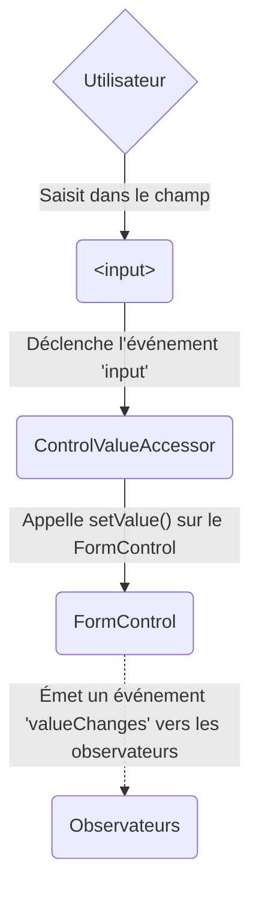
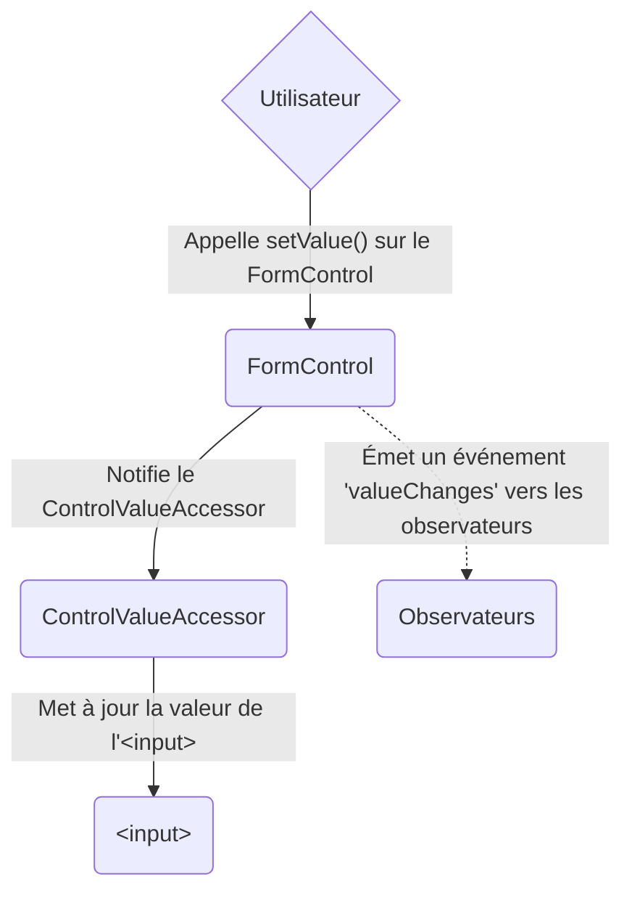
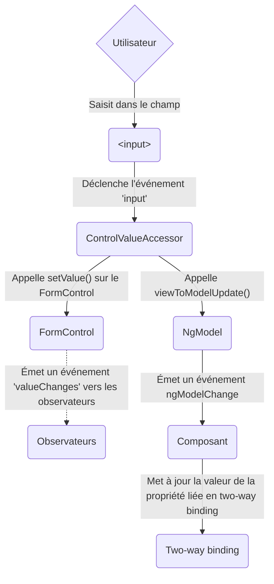
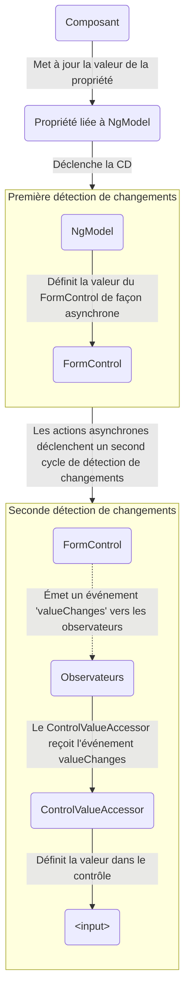

<!-- source: f637747cffae98c0b3cc386e6c751ef909b9f413 -->
<docs-decorative-header title="Les formulaires dans Angular" imgSrc="adev/src/assets/images/overview.svg"> <!-- markdownlint-disable-line -->
La gestion des saisies de l'utilisateur avec des formulaires est la pierre angulaire de nombreuses applications courantes.
</docs-decorative-header>

Les applications utilisent des formulaires pour permettre aux utilisateurs de se connecter, de mettre à jour un profil, de saisir des informations sensibles et d'effectuer de nombreuses autres tâches de saisie de données.

Angular propose deux approches différentes pour gérer les saisies de l'utilisateur via des formulaires : les reactive forms et les template-driven forms.

Les deux capturent les événements de saisie de l'utilisateur depuis la vue, valident la saisie, créent un model de formulaire et un modèle de données, et offrent un moyen de suivre les changements.

TIP: Si vous cherchez les nouveaux Signal Forms, consultez notre [guide des Fondamentaux sur les Signal Forms](/essentials/signal-forms) !

Ce guide fournit des informations pour vous aider à choisir le type de formulaire le mieux adapté à votre situation.
Il présente les briques de base communes aux deux approches.
Il résume aussi les principales différences entre les deux approches, et illustre ces différences dans le contexte de la mise en place, du flux de données et des tests.

## Choisir une approche {#choosing-an-approach}

Les reactive forms et les template-driven forms traitent et gèrent les données de formulaire différemment.
Chaque approche offre des avantages différents.

| Formulaires           | Détails |
| :-------------------- | :------------------------------------------------------------------------------------------------------------------------------------------------------------------------------------------------------------------------------------------------------------------------------------------------------------------------------------------------------------------------------------------------------------------ |
| Reactive forms        | Offrent un accès direct et explicite au modèle objet sous-jacent du formulaire. Par rapport aux template-driven forms, ils sont plus robustes : ils sont plus évolutifs, réutilisables et testables. Si les formulaires sont un élément clé de votre application, ou si vous utilisez déjà des patterns réactifs pour construire votre application, utilisez les reactive forms. |
| Template-driven forms | S'appuient sur des directives dans le template pour créer et manipuler le modèle objet sous-jacent. Ils sont utiles pour ajouter un formulaire simple à une application, comme un formulaire d'inscription à une liste de diffusion. Ils sont simples à ajouter à une application, mais ils ne passent pas aussi bien à l'échelle que les reactive forms. Si vous avez des besoins de formulaire très basiques et une logique qui peut être gérée uniquement dans le template, les template-driven forms peuvent être un bon choix. |

### Principales différences {#key-differences}

Le tableau suivant résume les principales différences entre les reactive forms et les template-driven forms.

|                                                   | Reactive                             | Template-driven                 |
| :------------------------------------------------ | :----------------------------------- | :------------------------------ |
| [Mise en place du model de formulaire](#setting-up-the-form-model) | Explicite, créé dans la classe du composant | Implicite, créé par des directives |
| [Modèle de données](#mutability-of-the-data-model)       | Structuré et immuable             | Non structuré et mutable        |
| [Flux de données](#data-flow-in-forms)                  | Synchrone                          | Asynchrone                    |
| [Validation de formulaire](#form-validation)               | Fonctions                            | Directives                      |

### Évolutivité {#scalability}

Si les formulaires occupent une place centrale dans votre application, l'évolutivité est très importante.
Pouvoir réutiliser des models de formulaire entre composants est essentiel.

Les reactive forms sont plus évolutifs que les template-driven forms.
Ils offrent un accès direct à l'API de formulaire sous-jacente, et utilisent un [flux de données synchrone](#data-flow-in-reactive-forms) entre la vue et le modèle de données, ce qui facilite la création de formulaires à grande échelle.
Les reactive forms nécessitent moins de mise en place pour les tests, et les tests ne demandent pas une compréhension approfondie de la détection de changements pour tester correctement les mises à jour et la validation du formulaire.

Les template-driven forms se concentrent sur des scénarios simples et sont moins réutilisables.
Ils masquent l'API de formulaire sous-jacente derrière une abstraction, et utilisent un [flux de données asynchrone](#data-flow-in-template-driven-forms) entre la vue et le modèle de données.
L'abstraction des template-driven forms a aussi un impact sur les tests.
Les tests dépendent fortement de l'exécution manuelle de la détection de changements pour fonctionner correctement, et nécessitent plus de mise en place.

## Mettre en place le model de formulaire {#setting-up-the-form-model}

Les reactive forms comme les template-driven forms suivent les changements de valeur entre les éléments de saisie du formulaire avec lesquels les utilisateurs interagissent et les données du formulaire dans le modèle de votre composant.
Les deux approches partagent des briques de base sous-jacentes, mais diffèrent dans la façon dont vous créez et gérez les instances communes de contrôles de formulaire.

### Classes de base communes des formulaires {#common-form-foundation-classes}

Les reactive forms comme les template-driven forms reposent sur les classes de base suivantes.

| Classes de base        | Détails |
| :--------------------- | :---------------------------------------------------------------------------------- |
| `FormControl`          | Suit la valeur et le statut de validation d'un contrôle de formulaire individuel.               |
| `FormGroup`            | Suit les mêmes valeurs et statuts pour une collection de contrôles de formulaire.                |
| `FormArray`            | Suit les mêmes valeurs et statuts pour un tableau de contrôles de formulaire.                    |
| `ControlValueAccessor` | Crée un pont entre les instances Angular de `FormControl` et les éléments DOM natifs. |

### Mise en place dans les reactive forms {#setup-in-reactive-forms}

Avec les reactive forms, vous définissez le model de formulaire directement dans la classe du composant.
La directive `[formControl]` relie l'instance de `FormControl` créée explicitement à un élément de formulaire précis de la vue, à l'aide d'un value accessor interne.

Le composant suivant implémente un champ de saisie pour un seul contrôle, avec les reactive forms.
Dans cet exemple, le model de formulaire est l'instance de `FormControl`.

<docs-code language="angular-ts" path="adev/src/content/examples/forms-overview/src/app/reactive/favorite-color/favorite-color.component.ts"/>

IMPORTANT: Dans les reactive forms, le model de formulaire est la source de vérité ; il fournit la valeur et le statut de l'élément de formulaire à tout instant, via la directive `[formControl]` sur l'élément `<input>`.

### Mise en place dans les template-driven forms {#setup-in-template-driven-forms}

Dans les template-driven forms, le model de formulaire est implicite plutôt qu'explicite.
La directive `NgModel` crée et gère une instance de `FormControl` pour un élément de formulaire donné.

Le composant suivant implémente le même champ de saisie pour un seul contrôle, avec les template-driven forms.

<docs-code language="angular-ts" path="adev/src/content/examples/forms-overview/src/app/template/favorite-color/favorite-color.component.ts"/>

IMPORTANT: Dans un template-driven form, la source de vérité est le template. La directive `NgModel` gère automatiquement l'instance de `FormControl` pour vous.

## Flux de données dans les formulaires {#data-flow-in-forms}

Quand une application contient un formulaire, Angular doit garder la vue synchronisée avec le modèle du composant, et le modèle du composant synchronisé avec la vue.
Lorsque les utilisateurs modifient des valeurs et font des sélections via la vue, les nouvelles valeurs doivent être répercutées dans le modèle de données.
De même, lorsque la logique du programme modifie des valeurs dans le modèle de données, ces valeurs doivent être répercutées dans la vue.

Les reactive forms et les template-driven forms diffèrent dans la façon dont ils gèrent les données provenant de l'utilisateur ou de changements programmatiques.
Les diagrammes suivants illustrent les deux types de flux de données pour chaque type de formulaire, à l'aide du champ de saisie de couleur préférée défini plus haut.

### Flux de données dans les reactive forms {#data-flow-in-reactive-forms}

Dans les reactive forms, chaque élément de formulaire de la vue est directement relié au model de formulaire (une instance de `FormControl`).
Les mises à jour de la vue vers le model et du model vers la vue sont synchrones et ne dépendent pas de la façon dont l'interface est rendue.

Le diagramme vue-vers-model montre comment les données circulent lorsque la valeur d'un champ de saisie est modifiée depuis la vue, à travers les étapes suivantes :

1. L'utilisateur saisit une valeur dans l'élément de saisie, ici la couleur préférée _Blue_.
1. L'élément de saisie du formulaire émet un événement « input » avec la dernière valeur.
1. Le `ControlValueAccessor` qui écoute les événements sur l'élément de saisie du formulaire transmet immédiatement la nouvelle valeur à l'instance de `FormControl`.
1. L'instance de `FormControl` émet la nouvelle valeur via l'observable `valueChanges`.
1. Tous les abonnés à l'observable `valueChanges` reçoivent la nouvelle valeur.

Le diagramme model-vers-vue montre comment un changement programmatique du model est propagé à la vue, à travers les étapes suivantes.

1. L'utilisateur appelle la méthode `favoriteColorControl.setValue()`, qui met à jour la valeur du `FormControl`.
1. L'instance de `FormControl` émet la nouvelle valeur via l'observable `valueChanges`.
1. Tous les abonnés à l'observable `valueChanges` reçoivent la nouvelle valeur.
1. Le control value accessor de l'élément de saisie du formulaire met à jour l'élément avec la nouvelle valeur.

### Flux de données dans les template-driven forms {#data-flow-in-template-driven-forms}

Dans les template-driven forms, chaque élément de formulaire est relié à une directive qui gère le model de formulaire en interne.

Le diagramme vue-vers-model montre comment les données circulent lorsque la valeur d'un champ de saisie est modifiée depuis la vue, à travers les étapes suivantes.

1. L'utilisateur saisit _Blue_ dans l'élément de saisie.
1. L'élément de saisie émet un événement « input » avec la valeur _Blue_.
1. Le control value accessor attaché au champ de saisie déclenche la méthode `setValue()` sur l'instance de `FormControl`.
1. L'instance de `FormControl` émet la nouvelle valeur via l'observable `valueChanges`.
1. Tous les abonnés à l'observable `valueChanges` reçoivent la nouvelle valeur.
1. Le control value accessor appelle aussi la méthode `NgModel.viewToModelUpdate()`, qui émet un événement `ngModelChange`.
1. Comme le template du composant utilise le two-way binding pour la propriété `favoriteColor`, la propriété `favoriteColor` du composant est mise à jour avec la valeur émise par l'événement `ngModelChange` \(_Blue_\).

Le diagramme model-vers-vue montre comment les données circulent du model vers la vue lorsque `favoriteColor` passe de _Blue_ à _Red_, à travers les étapes suivantes

1. La valeur de `favoriteColor` est mise à jour dans le composant.
1. La détection de changements commence.
1. Pendant la détection de changements, le lifecycle hook `ngOnChanges` est appelé sur l'instance de la directive `NgModel`, car la valeur de l'un de ses inputs a changé.
1. La méthode `ngOnChanges()` met en file d'attente une tâche asynchrone pour définir la valeur de l'instance interne de `FormControl`.
1. La détection de changements se termine.
1. Au tick suivant, la tâche qui définit la valeur de l'instance de `FormControl` est exécutée.
1. L'instance de `FormControl` émet la dernière valeur via l'observable `valueChanges`.
1. Tous les abonnés à l'observable `valueChanges` reçoivent la nouvelle valeur.
1. Le control value accessor met à jour l'élément de saisie du formulaire dans la vue avec la dernière valeur de `favoriteColor`.

NOTE: `NgModel` déclenche une seconde détection de changements pour éviter les erreurs `ExpressionChangedAfterItHasBeenChecked`, car le changement de valeur provient d'un input binding.

### Mutabilité du modèle de données {#mutability-of-the-data-model}

La méthode de suivi des changements joue un rôle dans l'efficacité de votre application.

| Formulaires           | Détails |
| :-------------------- | :--------------------------------------------------------------------------------------------------------------------------------------------------------------------------------------------------------------------------------------------------------------------------------------------------------------------------------------------------------------------------------------------------------------------------------------------------------------------------------------------------------------------------------------------------------- |
| Reactive forms        | Gardent le modèle de données pur en le fournissant sous forme de structure de données immuable. Chaque fois qu'un changement est déclenché sur le modèle de données, l'instance de `FormControl` renvoie un nouveau modèle de données plutôt que de mettre à jour le modèle existant. Cela vous permet de suivre les changements uniques du modèle de données via l'observable du contrôle. La détection de changements est plus efficace, car elle n'a besoin de se mettre à jour que lors de changements uniques. Comme les mises à jour de données suivent des patterns réactifs, vous pouvez les intégrer avec les opérateurs d'observables pour transformer les données. |
| Template-driven forms | S'appuient sur la mutabilité avec le two-way binding pour mettre à jour le modèle de données du composant à mesure que des changements sont effectués dans le template. Comme il n'y a pas de changements uniques à suivre sur le modèle de données avec le two-way binding, la détection de changements est moins efficace pour déterminer quand des mises à jour sont nécessaires. |

La différence est illustrée dans les exemples précédents qui utilisent l'élément de saisie de couleur préférée.

- Avec les reactive forms, l'**instance de `FormControl`** renvoie toujours une nouvelle valeur quand la valeur du contrôle est mise à jour
- Avec les template-driven forms, la **propriété de couleur préférée** est toujours modifiée avec sa nouvelle valeur

## Validation de formulaire {#form-validation}

La validation fait partie intégrante de la gestion de tout ensemble de formulaires.
Que vous vérifiiez des champs obligatoires ou que vous interrogiez une API externe pour savoir si un nom d'utilisateur existe déjà, Angular fournit un ensemble de validateurs intégrés ainsi que la possibilité de créer des validateurs personnalisés.

| Formulaires           | Détails |
| :-------------------- | :----------------------------------------------------------------------------------------------------------- |
| Reactive forms        | Définissez des validateurs personnalisés sous forme de **fonctions** qui reçoivent un contrôle à valider |
| Template-driven forms | Liés à des **directives** de template ; vous devez fournir des directives de validateur personnalisées qui encapsulent des fonctions de validation |

Pour plus d'informations, consultez [Validation de formulaire](guide/forms/form-validation#validating-input-in-reactive-forms).

## Tests {#testing}

Les tests jouent un rôle important dans les applications complexes.
Une stratégie de test plus simple est utile pour vérifier que vos formulaires fonctionnent correctement.
Les reactive forms et les template-driven forms dépendent à des degrés différents du rendu de l'interface pour effectuer des assertions basées sur les changements des contrôles et des champs de formulaire.
Les exemples suivants illustrent le processus de test des formulaires avec les reactive forms et les template-driven forms.

### Tester les reactive forms {#testing-reactive-forms}

Les reactive forms offrent une stratégie de test relativement simple, car ils donnent un accès synchrone au formulaire et aux modèles de données, et peuvent être testés sans rendre l'interface.
Dans ces tests, le statut et les données sont interrogés et manipulés via le contrôle, sans interagir avec le cycle de détection de changements.

Les tests suivants utilisent les composants de couleur préférée des exemples précédents pour vérifier les flux de données vue-vers-model et model-vers-vue d'un reactive form.

<!--todo: make consistent with other topics -->

#### Vérifier le flux de données de la vue vers le model {#verifying-view-to-model-data-flow}

Le premier exemple effectue les étapes suivantes pour vérifier le flux de données de la vue vers le model.

1. Interrogez la vue pour obtenir l'élément de saisie du formulaire, et créez un événement « input » personnalisé pour le test.
1. Définissez la nouvelle valeur du champ de saisie à _Red_, et émettez l'événement « input » sur l'élément de saisie du formulaire.
1. Vérifiez que la valeur de `favoriteColorControl` du composant correspond à la valeur du champ de saisie.

<docs-code header="Test de couleur préférée - de la vue vers le model" path="adev/src/content/examples/forms-overview/src/app/reactive/favorite-color/favorite-color.component.spec.ts" region="view-to-model"/>

L'exemple suivant effectue les étapes suivantes pour vérifier le flux de données du model vers la vue.

1. Utilisez `favoriteColorControl`, une instance de `FormControl`, pour définir la nouvelle valeur.
1. Interrogez la vue pour obtenir l'élément de saisie du formulaire.
1. Vérifiez que la nouvelle valeur définie sur le contrôle correspond à la valeur du champ de saisie.

<docs-code header="Test de couleur préférée - du model vers la vue" path="adev/src/content/examples/forms-overview/src/app/reactive/favorite-color/favorite-color.component.spec.ts" region="model-to-view"/>

### Tester les template-driven forms {#testing-template-driven-forms}

Écrire des tests avec les template-driven forms nécessite une connaissance détaillée du processus de détection de changements et une compréhension de la façon dont les directives s'exécutent à chaque cycle, afin de garantir que les éléments sont interrogés, testés ou modifiés au bon moment.

Les tests suivants utilisent les composants de couleur préférée mentionnés plus haut pour vérifier les flux de données de la vue vers le model et du model vers la vue d'un template-driven form.

Le test suivant vérifie le flux de données de la vue vers le model.

<docs-code header="Test de couleur préférée - de la vue vers le model" path="adev/src/content/examples/forms-overview/src/app/template/favorite-color/favorite-color.component.spec.ts" region="view-to-model"/>

Voici les étapes effectuées dans le test de la vue vers le model.

1. Interrogez la vue pour obtenir l'élément de saisie du formulaire, et créez un événement « input » personnalisé pour le test.
1. Définissez la nouvelle valeur du champ de saisie à _Red_, et émettez l'événement « input » sur l'élément de saisie du formulaire.
1. Exécutez la détection de changements via la fixture de test.
1. Vérifiez que la valeur de la propriété `favoriteColor` du composant correspond à la valeur du champ de saisie.

Le test suivant vérifie le flux de données du model vers la vue.

<docs-code header="Test de couleur préférée - du model vers la vue" path="adev/src/content/examples/forms-overview/src/app/template/favorite-color/favorite-color.component.spec.ts" region="model-to-view"/>

Voici les étapes effectuées dans le test du model vers la vue.

1. Utilisez l'instance du composant pour définir la valeur de la propriété `favoriteColor`.
1. Exécutez la détection de changements via la fixture de test.
1. Utilisez `await fixture.whenStable()` pour attendre le prochain rendu.
1. Interrogez la vue pour obtenir l'élément de saisie du formulaire.
1. Vérifiez que la valeur du champ de saisie correspond à la valeur de la propriété `favoriteColor` de l'instance du composant.

## Prochaines étapes {#next-steps}

Pour en savoir plus sur les reactive forms, consultez les guides suivants :

<docs-pill-row>
  <docs-pill href="guide/forms/reactive-forms" title="Reactive forms"/>
  <docs-pill href="guide/forms/form-validation#validating-input-in-reactive-forms" title="Validation de formulaire"/>
  <docs-pill href="guide/forms/dynamic-forms" title="Formulaires dynamiques"/>
</docs-pill-row>

Pour en savoir plus sur les template-driven forms, consultez les guides suivants :

<docs-pill-row>
  <docs-pill href="guide/forms/template-driven-forms" title="Tutoriel sur les template-driven forms" />
  <docs-pill href="guide/forms/form-validation#validating-input-in-template-driven-forms" title="Validation de formulaire" />
  <docs-pill href="api/forms/NgForm" title="Référence de l'API de la directive NgForm" />
</docs-pill-row>
