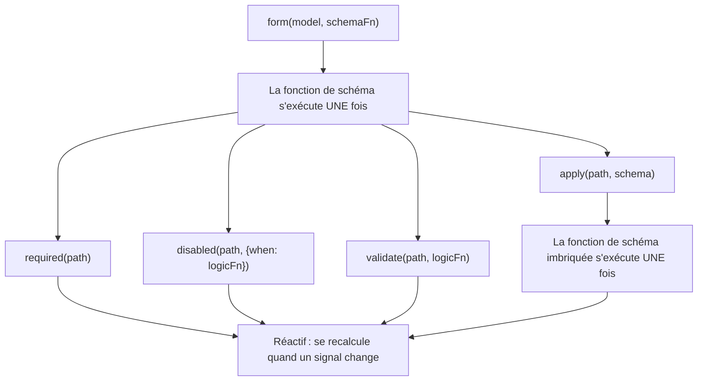

<!-- source: 12125844103d099cf7c03230e2c1467e8fca369e -->
# Schémas et composabilité des schémas

Les Signal Forms reposent sur une architecture à deux couches pour séparer _la structure de votre formulaire_ de _son comportement à l'exécution_.

Lorsque vous passez une fonction de schéma à `form()`, cette fonction _s'exécute une seule fois_ lors de la création du formulaire. Son rôle est de mettre en place l'arbre logique du formulaire en déclarant quels champs ont une validation, quels champs sont désactivés et quels champs dépendent d'autres champs. C'est la **couche structurelle** de votre formulaire.

Dans une fonction de schéma, vous appelez des fonctions de règle comme `disabled()` et `validate()`. Ces fonctions de règle acceptent une logique réactive qui se recalcule chaque fois que les signals qu'elle référence changent. Les règles conditionnelles comme `disabled()` et `required()` acceptent une configuration optionnelle, notamment une fonction `when` qui active la règle. Ensemble, elles forment la **couche comportementale** de votre formulaire à l'exécution.

```ts
contactForm = form(this.contactModel, (schemaPath) => {
  // Schema function: runs ONCE during form creation
  required(schemaPath.name);
  disabled(schemaPath.couponCode, {when: ({valueOf}) => valueOf(schemaPath.total) < 50});
  //  ^^^ Reactive logic: recomputes when total changes
});
```



Cette distinction est importante lorsque vous composez des schémas, car des fonctions comme `apply()`, `applyWhen()` et `schema()` opèrent toutes au niveau de la couche structurelle. Les schémas contrôlent _quelles_ règles existent et _si_ elles sont actives, tandis que les fonctions de règle définissent _ce que_ ces règles évaluent.

## Créer des schémas réutilisables avec `schema()` {#create-reusable-schemas-with-schema}

Lorsque plusieurs formulaires partagent les mêmes règles pour une même forme de données, vous pouvez utiliser la fonction `schema()` pour extraire ces règles dans un schéma réutilisable.

```ts
import {schema, required, minLength} from '@angular/forms/signals';

const nameSchema = schema<{first: string; last: string}>((name) => {
  required(name.first);
  required(name.last);
  minLength(name.first, 2);
  minLength(name.last, 2);
});
```

La fonction `schema()` enveloppe une fonction et la convertit en un objet `Schema<T>` réutilisable. Comme toute fonction de schéma, elle _s'exécute une seule fois_ par formulaire, mais l'objet lui-même peut être partagé entre autant de formulaires que nécessaire.

TIP: Si des règles n'apparaissent qu'à un seul endroit, une fonction de schéma inline fonctionne tout aussi bien. Utilisez `schema()` lorsque vous voulez réutiliser le même schéma dans plusieurs formulaires ou appliquer le même schéma à plusieurs chemins. Les objets `Schema` réutilisables sont mis en cache à chaque compilation de formulaire.

### Utiliser le schéma avec `apply()` {#using-the-schema-with-apply}

Vous pouvez appliquer un schéma réutilisable à un chemin précis d'un formulaire avec la fonction `apply()`. Lorsque vous appelez `apply()`, le schéma reçoit un chemin restreint qui ne voit que les champs de ce sous-chemin :

```ts
import {apply, form} from '@angular/forms/signals';

profileForm = form(this.profileModel, (schemaPath) => {
  apply(schemaPath.name, nameSchema);
});

registrationForm = form(this.registrationModel, (schemaPath) => {
  apply(schemaPath.name, nameSchema);
});
```

## Schémas conditionnels avec `applyWhen()` {#conditional-schemas-with-applywhen}

NOTE: Le [guide Ajouter de la logique de formulaire](guide/forms/signals/form-logic) a présenté `applyWhen()` pour les règles conditionnelles avec une logique inline. Cette section explique comment composer `applyWhen()` avec des schémas réutilisables.

Certaines règles ne doivent s'appliquer que dans certaines conditions. Par exemple, un champ de code postal peut ne nécessiter une validation que lorsque le pays sélectionné est les États-Unis.

La fonction `applyWhen()` applique un schéma de manière conditionnelle en fonction d'un état réactif. Elle accepte trois arguments :

1. Un chemin auquel appliquer le schéma
1. Une fonction de logique réactive qui renvoie `true` lorsque le schéma doit être actif
1. Un schéma ou une fonction de schéma contenant les règles conditionnelles

```ts
import {form, applyWhen, required, pattern} from '@angular/forms/signals';

addressForm = form(this.addressModel, (schemaPath) => {
  applyWhen(
    schemaPath,
    ({valueOf}) => valueOf(schemaPath.country) === 'US',
    (schemaPath) => {
      required(schemaPath.zipCode);
      pattern(schemaPath.zipCode, /^\d{5}(-\d{4})?$/);
    },
  );
});
```

La fonction de logique reçoit un `FieldContext`, qui donne accès à `value`, `valueOf`, `stateOf` et à d'autres helpers réactifs. Comme elle est réactive, la condition est réévaluée chaque fois que les signals qu'elle lit changent. Lorsque la condition devient `false`, les règles du schéma se désactivent. Lorsqu'elle redevient `true`, elles se réactivent.

Le schéma lui-même reste structurel : la fonction de schéma s'exécute une seule fois lors de la création du formulaire. La condition contrôle si ces règles sont _actives_, et non si elles _existent_.

Dans le schéma conditionnel, utilisez le paramètre de chemin restreint passé à cette fonction de schéma. Les chemins d'un schéma externe ne sont pas valides dans un schéma imbriqué.

### Combiner `applyWhen()` avec des schémas réutilisables {#combining-applywhen-with-reusable-schemas}

Comme `applyWhen()` accepte un objet `Schema`, vous pouvez l'associer à `schema()` pour appliquer des schémas réutilisables de manière conditionnelle :

```ts
const usZipCodeSchema = schema<{zipCode: string}>((address) => {
  required(address.zipCode);
  pattern(address.zipCode, /^\d{5}(-\d{4})?$/);
});

const caPostalCodeSchema = schema<{postalCode: string}>((address) => {
  required(address.postalCode);
  pattern(address.postalCode, /^[A-Z]\d[A-Z] \d[A-Z]\d$/);
});

shippingForm = form(this.shippingModel, (schemaPath) => {
  applyWhen(
    schemaPath.address,
    ({valueOf}) => valueOf(schemaPath.country) === 'US',
    usZipCodeSchema,
  );
  applyWhen(
    schemaPath.address,
    ({valueOf}) => valueOf(schemaPath.country) === 'CA',
    caPostalCodeSchema,
  );
});
```

NOTE: La fonction de logique accède à `valueOf(schemaPath.country)` alors que l'argument de chemin est `schemaPath.address`. C'est possible parce que le helper `valueOf` peut accéder à n'importe quel champ du formulaire, et pas seulement aux champs du chemin restreint.

Ce pattern garde la logique de validation modulaire : les règles d'adresse de chaque pays vivent dans leur propre schéma, et le formulaire choisit lequel activer selon le choix de l'utilisateur.

## Affinage de type avec `applyWhenValue()` {#type-narrowing-with-applywhenvalue}

La fonction `applyWhenValue()` simplifie les conditions qui n'ont besoin de vérifier que la valeur du champ. Au lieu de recevoir un `FieldContext`, la fonction de condition reçoit directement la valeur brute du champ.

```ts {header: "applyWhen — logic function receives FieldContext"}
applyWhen(schemaPath.payment, ({value}) => value().type === 'credit-card', creditCardSchema);
```

```ts {header: "applyWhenValue — condition receives the value directly"}
applyWhenValue(schemaPath.payment, (payment) => payment.type === 'credit-card', creditCardSchema);
```

Le principal avantage de `applyWhenValue()` est la prise en charge des type guards TypeScript. Lorsque la fonction de condition est un type guard, le paramètre de type du schéma est affiné vers le type protégé. C'est particulièrement utile pour les unions discriminées, où chaque variante possède des champs différents qui nécessitent des règles différentes.

```ts
import {form, applyWhenValue, required} from '@angular/forms/signals';

interface CreditCard {
  type: 'credit-card';
  cardNumber: string;
  expiry: string;
  cvv: string;
}

interface BankTransfer {
  type: 'bank-transfer';
  accountNumber: string;
  routingNumber: string;
}

type PaymentMethod = CreditCard | BankTransfer;

function isCreditCard(value: PaymentMethod): value is CreditCard {
  return value.type === 'credit-card';
}

function isBankTransfer(value: PaymentMethod): value is BankTransfer {
  return value.type === 'bank-transfer';
}

paymentForm = form(this.paymentModel, (schemaPath) => {
  applyWhenValue(schemaPath, isCreditCard, (payment) => {
    // TypeScript knows payment is scoped to CreditCard
    required(payment.cardNumber);
    required(payment.expiry);
    required(payment.cvv);
  });

  applyWhenValue(schemaPath, isBankTransfer, (payment) => {
    // TypeScript knows payment is scoped to BankTransfer
    required(payment.accountNumber);
    required(payment.routingNumber);
  });
});
```

Sans le type guard, TypeScript ne saurait pas quels champs sont disponibles dans chaque fonction de schéma. L'affinage de type garantit que l'accès à `payment.cardNumber` est sûr au niveau du typage dans la branche carte bancaire, et que l'accès à `payment.accountNumber` l'est dans la branche virement bancaire.

## Éléments de tableau avec `applyEach()` {#array-items-with-applyeach}

Lorsqu'un formulaire contient un tableau d'objets, vous avez souvent besoin d'appliquer les mêmes règles à chaque élément. La fonction `applyEach()` applique un schéma à chaque élément d'un champ de type tableau, quel que soit le nombre d'éléments.

```ts
import {form, applyEach, required, min} from '@angular/forms/signals';

type LineItem = {name: string; quantity: number};

orderForm = form(this.orderModel, (schemaPath) => {
  required(schemaPath.title);

  applyEach(schemaPath.items, (item) => {
    required(item.name);
    min(item.quantity, 1);
  });
});
```

La fonction de schéma passée à `applyEach()` reçoit un `SchemaPathTree` restreint à un seul élément du tableau. Les règles déclarées à l'intérieur s'appliquent à chaque élément du tableau, y compris aux éléments ajoutés après la création du formulaire.

### Combiner `applyEach()` avec des schémas réutilisables {#combining-applyeach-with-reusable-schemas}

Comme `applyEach()` accepte un objet `Schema`, vous pouvez extraire les règles propres à chaque élément dans un schéma réutilisable et les partager entre plusieurs formulaires :

```ts
const lineItemSchema = schema<LineItem>((item) => {
  required(item.name);
  min(item.quantity, 1);
});

orderForm = form(this.orderModel, (schemaPath) => {
  required(schemaPath.title);
  applyEach(schemaPath.items, lineItemSchema);
});

invoiceForm = form(this.invoiceModel, (schemaPath) => {
  required(schemaPath.invoiceNumber);
  applyEach(schemaPath.lineItems, lineItemSchema);
});
```

TIP: Pour en savoir plus sur la validation des éléments de tableau, notamment les messages d'erreur personnalisés par champ, consultez le [guide Validation](guide/forms/signals/validation).

## Prochaines étapes {#next-steps}

Pour en savoir plus sur les Signal Forms, consultez ces guides associés :

- [Ajouter de la logique de formulaire](guide/forms/signals/form-logic) - Découvrez comment ajouter de la logique conditionnelle, un comportement dynamique et des métadonnées à vos formulaires
- [Validation](guide/forms/signals/validation) - Découvrez les règles de validation et la gestion des erreurs
- [Opérations asynchrones](guide/forms/signals/async-operations) - Découvrez comment gérer la soumission de formulaire et la validation asynchrone
