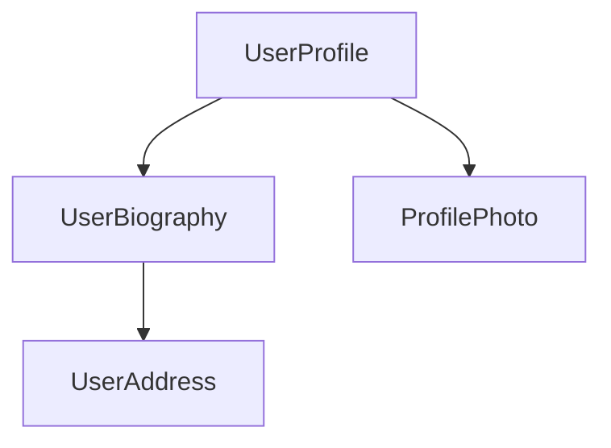

<!-- source: bfc48a69bad52cdbfb9aee4c2b082c31be526d20 -->
<docs-decorative-header title="Composants" imgSrc="adev/src/assets/images/components.svg"> <!-- markdownlint-disable-line -->
La brique fondamentale pour créer des applications avec Angular.
</docs-decorative-header>

Les composants sont les principales briques des applications Angular. Chaque composant représente une partie d'une page web plus grande. Organiser une application en composants aide à structurer votre projet, en séparant clairement le code en parties spécifiques, faciles à maintenir et à faire évoluer.

## Définir un composant {#defining-a-component}

Chaque composant comporte quelques parties principales :

1. Un [décorateur](https://www.typescriptlang.org/docs/handbook/decorators.html) `@Component` qui contient la configuration utilisée par Angular.
2. Un template HTML qui contrôle ce qui est rendu dans le DOM.
3. Un [sélecteur CSS](https://developer.mozilla.org/docs/Learn/CSS/Building_blocks/Selectors) qui définit comment le composant est utilisé dans le HTML.
4. Une classe TypeScript avec des comportements, comme la gestion des saisies de l'utilisateur ou l'envoi de requêtes à un serveur.

Voici un exemple simplifié d'un composant `UserProfile`.

```angular-ts {header: "user-profile.ts"}
@Component({
  selector: 'user-profile',
  template: `
    <h1>User profile</h1>
    <p>This is the user profile page</p>
  `,
})
export class UserProfile {
  /* Your component code goes here */
}
```

Le décorateur `@Component` accepte aussi, de façon facultative, une propriété `styles` pour le CSS que vous souhaitez appliquer à votre template :

```angular-ts {header: "user-profile.ts"}
@Component({
  selector: 'user-profile',
  template: `
    <h1>User profile</h1>
    <p>This is the user profile page</p>
  `,
  styles: `
    h1 {
      font-size: 3em;
    }
  `,
})
export class UserProfile {
  /* Your component code goes here */
}
```

### Séparer le HTML et le CSS dans des fichiers distincts {#separating-html-and-css-into-separate-files}

Vous pouvez définir le HTML et le CSS d'un composant dans des fichiers distincts avec `templateUrl` et `styleUrl` :

```angular-ts {header: "user-profile.ts"}
@Component({
  selector: 'user-profile',
  templateUrl: 'user-profile.html',
  styleUrl: 'user-profile.css',
})
export class UserProfile {
  // Component behavior is defined in here
}
```

```angular-html {header: "user-profile.html"}
<h1>User profile</h1>
<p>This is the user profile page</p>
```

```css {header: "user-profile.css"}
h1 {
  font-size: 3em;
}
```

## Utiliser des composants {#using-components}

Vous construisez une application en composant plusieurs composants entre eux. Par exemple, si vous créez une page de profil utilisateur, vous pourriez découper la page en plusieurs composants comme ceci :



Ici, le composant `UserProfile` utilise plusieurs autres composants pour produire la page finale.

Pour importer et utiliser un composant, vous devez :

1. Dans le fichier TypeScript de votre composant, ajouter une instruction `import` pour le composant que vous voulez utiliser.
2. Dans votre décorateur `@Component`, ajouter une entrée au tableau `imports` pour le composant que vous voulez utiliser.
3. Dans le template de votre composant, ajouter un élément qui correspond au sélecteur du composant que vous voulez utiliser.

Voici un exemple d'un composant `UserProfile` qui importe un composant `ProfilePhoto` :

```angular-ts {header: "user-profile.ts"}
import {Component} from '@angular/core';
import {ProfilePhoto} from './profile-photo';

@Component({
  selector: 'user-profile',
  imports: [ProfilePhoto],
  template: `
    <h1>User profile</h1>
    <profile-photo />
    <p>This is the user profile page</p>
  `,
})
export class UserProfile {
  // Component behavior is defined in here
}
```

TIP: Vous voulez en savoir plus sur les composants Angular ? Consultez le [guide approfondi des composants](guide/components) pour tous les détails.

## Étape suivante {#next-step}

Maintenant que vous savez comment fonctionnent les composants dans Angular, il est temps d'apprendre à ajouter et gérer des données dynamiques dans votre application.

<docs-pill-row>
  <docs-pill title="La réactivité avec les signals" href="essentials/signals" />
  <docs-pill title="Guide approfondi des composants" href="guide/components" />
</docs-pill-row>
