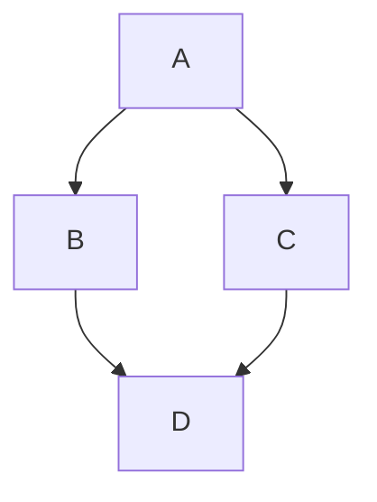
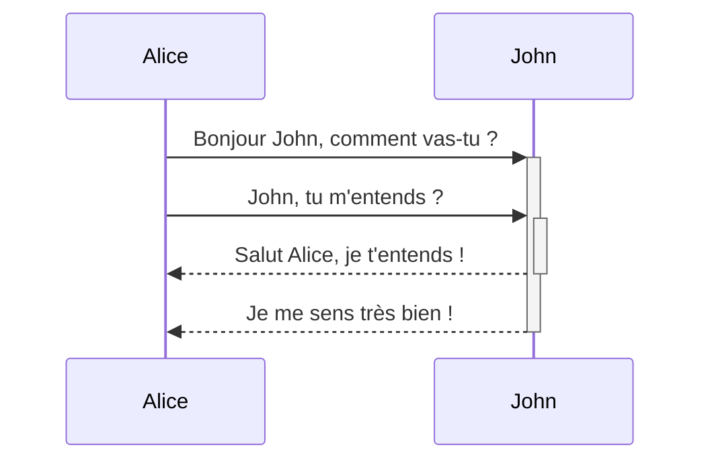
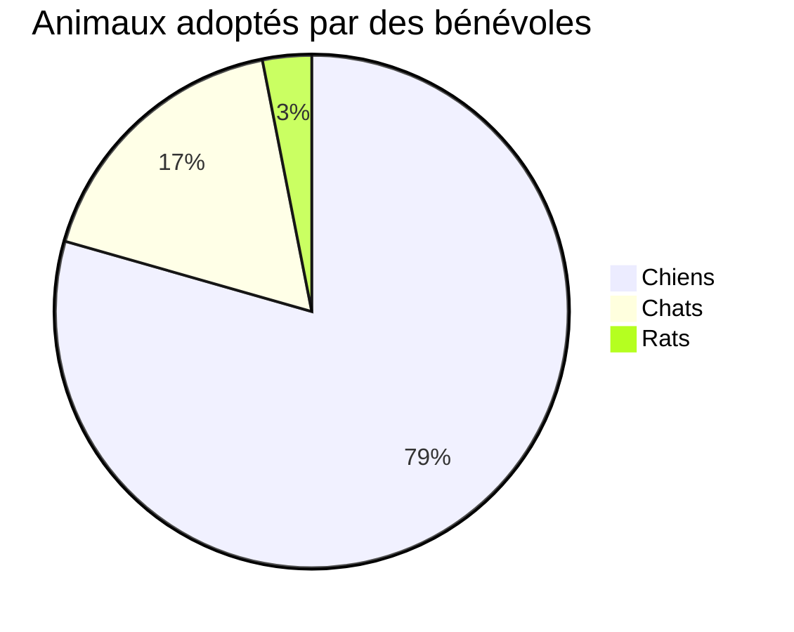

<!-- source: d8b85ced53336d80f8432b846e22986bffd37867 -->
<docs-decorative-header title="Kitchen sink" imgSrc="adev/src/assets/images/components.svg"> <!-- markdownlint-disable-line -->
Voici une liste visuelle de tous les composants et styles personnalisés d'Angular.dev.
</docs-decorative-header>

En tant que design system, cette page contient des recommandations visuelles et de rédaction Markdown pour :

- Les éléments personnalisés de la documentation Angular : [`docs-card`](#cards), [`docs-callout`](#callouts), [`docs-pill`](#pills) et [`docs-steps`](#workflow)
- Les éléments de texte personnalisés : [alertes](#alerts)
- Les exemples de code : [`docs-code`](#code)
- Les éléments Markdown natifs stylés : liens, listes, [titres](#headers-h2), [lignes horizontales](#horizontal-line-divider)
- et bien plus !

Préparez-vous à :

1. Écrire...
2. une super...
3. documentation !

## Titres (h2) {#headers-h2}

### Titres plus petits (h3) {#smaller-headers-h3}

#### Encore plus petits (h4) {#even-smaller-h4}

##### Toujours plus petits (h5) {#even-more-smaller-h5}

###### Les plus petits ! (h6) {#the-smallest-h6}

## Cartes {#cards}

<docs-card-container>
  <docs-card title="Qu'est-ce qu'Angular ?" link="Présentation de la plateforme" href="tutorials/first-app">
    Lorem ipsum dolor sit amet, consectetur adipiscing elit. Nullam ornare ligula nisi
  </docs-card>
  <docs-card title="Deuxième carte" link="Essayer maintenant" href="essentials/what-is-angular">
    Lorem ipsum dolor sit amet, consectetur adipiscing elit. Nullam ornare ligula nisi
  </docs-card>
    <docs-card title="Carte sans lien">
    Lorem ipsum dolor sit amet, consectetur adipiscing elit. Nullam ornare ligula nisi
  </docs-card>
</docs-card-container>

### Attributs de `<docs-card>` {#docs-card-attributes}

| Attributs               | Détails                                           |
| :---------------------- | :------------------------------------------------ |
| `<docs-card-container>` | Toutes les cartes doivent être imbriquées dans un conteneur |
| `title`                 | Titre de la carte                                 |
| contenu de la carte     | Tout ce qui se trouve entre `<docs-card>` et `</docs-card>` |
| `link`                  | (Facultatif) Texte du lien d'appel à l'action     |
| `href`                  | (Facultatif) href du lien d'appel à l'action      |

## Encadrés {#callouts}

<docs-callout title="Titre d'un encadré utile">
  Lorem ipsum dolor sit amet, consectetur adipiscing elit. Nulla luctus metus blandit semper faucibus. Sed blandit diam quis tellus maximus, ac scelerisque ex egestas. Ut euismod lobortis mauris pretium iaculis. Quisque ullamcorper, elit ut lacinia blandit, magna sem finibus urna, vel suscipit tortor dolor id risus.
</docs-callout>

<docs-callout critical title="Titre d'un encadré critique">
  Lorem ipsum dolor sit amet, consectetur adipiscing elit. Nulla luctus metus blandit semper faucibus. Sed blandit diam quis tellus maximus, ac scelerisque ex egestas. Ut euismod lobortis mauris pretium iaculis. Quisque ullamcorper, elit ut lacinia blandit, magna sem finibus urna, vel suscipit tortor dolor id risus.
</docs-callout>

<docs-callout important title="Titre d'un encadré important">
  Lorem ipsum dolor sit amet, consectetur adipiscing elit. Nulla luctus metus blandit semper faucibus. Sed blandit diam quis tellus maximus, ac scelerisque ex egestas. Ut euismod lobortis mauris pretium iaculis. Quisque ullamcorper, elit ut lacinia blandit, magna sem finibus urna, vel suscipit tortor dolor id risus.
</docs-callout>

### Attributs de `<docs-callout>` {#docs-callout-attributes}

| Attributs                                        | Détails                                                   |
| :----------------------------------------------- | :-------------------------------------------------------- |
| `title`                                          | Titre de l'encadré                                        |
| contenu de la carte                              | Tout ce qui se trouve entre `<docs-callout>` et `</docs-callout>` |
| `helpful` (par défaut) \| `critical` \| `important` | (Facultatif) Ajoute un style et des icônes selon le niveau de gravité |

## Pills {#pills}

Les rangées de pills sont utiles comme une sorte de navigation, avec des liens vers des ressources utiles.

<docs-pill-row id=pill-row>
  <docs-pill href="#pill-row" title="Lien"/>
  <docs-pill href="#pill-row" title="Lien"/>
  <docs-pill href="#pill-row" title="Lien"/>
  <docs-pill href="#pill-row" title="Lien"/>
  <docs-pill href="#pill-row" title="Lien"/>
  <docs-pill href="#pill-row" title="Lien"/>
</docs-pill-row>

### Attributs de `<docs-pill>` {#docs-pill-attributes}

| Attributs        | Détails                                    |
| :--------------- | :----------------------------------------- |
| `<docs-pill-row` | Toutes les pills doivent être imbriquées dans une rangée de pills |
| `title`          | Texte de la pill                           |
| `href`           | href de la pill                            |

Les pills peuvent aussi être utilisées seules, en ligne, mais nous ne l'avons pas encore développé.

## Alertes {#alerts}

Les alertes ne sont que des paragraphes spéciaux. Elles servent à mettre en avant (à ne pas confondre avec un encadré) quelque chose d'un peu plus urgent. Leur taille de police dépend du contexte et elles existent en plusieurs niveaux. Évitez d'utiliser les alertes pour afficher trop de contenu ; servez-vous-en plutôt pour enrichir le contenu environnant et attirer l'attention sur celui-ci.

Stylez les alertes en commençant une nouvelle ligne en Markdown avec le format `SEVERITY_LEVEL` + `:` + `ALERT_TEXT`.

NOTE: Utilisez Note pour des informations annexes ou complémentaires qui ne sont pas _essentielles_ au texte principal.

TIP: Utilisez Tip pour mettre en avant une tâche ou une action précise que les utilisateurs peuvent effectuer, ou un fait directement lié à une tâche ou une action.

TODO: Utilisez TODO pour une documentation incomplète que vous prévoyez d'étoffer bientôt. Vous pouvez aussi assigner le TODO, par exemple TODO(emmatwersky) : Texte.

QUESTION: Utilisez Question pour poser une question au lecteur, un peu comme un mini-quiz auquel il devrait pouvoir répondre.

SUMMARY: Utilisez Summary pour fournir un résumé de deux ou trois phrases du contenu de la page ou de la section, afin que les lecteurs puissent savoir s'ils sont au bon endroit.

TLDR: Utilisez TL;DR (ou TLDR) si vous pouvez donner l'information essentielle d'une page ou d'une section en une phrase ou deux. Par exemple, TLDR : Rhubarb est un chat.

CRITICAL: Utilisez Critical pour signaler des risques potentiels ou avertir le lecteur qu'il doit être prudent avant de faire quelque chose. Par exemple, Avertissement : exécuter `rm` avec l'option `-f` supprime les fichiers ou répertoires protégés en écriture sans vous demander de confirmation.

IMPORTANT: Utilisez Important pour des informations essentielles à la compréhension du texte ou à la réalisation d'une tâche.

HELPFUL: Utilisez Best practice pour mettre en avant des pratiques reconnues comme efficaces ou meilleures que les alternatives.

NOTE: Attention, `developers` ! Les alertes _peuvent_ contenir un [lien](#alerts) et d'autres styles imbriqués (mais essayez de **les utiliser avec parcimonie**) !

## Code {#code}

Vous pouvez afficher du `code` avec les triples backticks natifs :

```ts
example code
```

Ou avec l'élément `<docs-code>`.

<docs-code header="Votre premier exemple" language="ts" linenums>
import { Component } from '@angular/core';

@Component({
selector: 'example-code',
template: '<h1>Hello World!</h1>',
})
export class ComponentOverviewComponent {}
</docs-code>

### Styliser l'exemple {#styling-the-example}

Voici un exemple de code entièrement stylé :

<docs-code
  path="adev/src/content/examples/hello-world/src/app/app.component-old.ts"
  header="Un exemple de code stylé"
  language='ts'
  linenums
  highlight="[[3,7], 9]"
  preview
  visibleLines="[3,10]">
</docs-code>

Nous avons aussi un style pour le terminal : il suffit de définir le langage sur `shell` :

```shell
npm install @angular/material --save
```

Vous pouvez styliser les triples backticks Markdown standard avec des attributs pour une présentation enrichie :

```ts {header:"Awesome Title", linenums, highlight: [2], hideCopy}
console.log('Hello, World!');
console.log('Awesome Angular Docs!');
```

#### Attributs de `<docs-code>` {#docs-code-attributes}

| Attributs      | Type                 | Détails                                                         |
| :------------- | :------------------- | :-------------------------------------------------------------- |
| code           | `string`             | Tout ce qui se trouve entre les balises est traité comme du code |
| `path`         | `string`             | Chemin vers l'exemple de code (racine : `content/examples/`)     |
| `header`       | `string`             | Titre de l'exemple (par défaut : `file-name`)                    |
| `language`     | `string`             | langage du code                                                 |
| `linenums`     | `boolean`            | (False) affiche les numéros de ligne                            |
| `highlight`    | `string of number[]` | lignes mises en évidence                                        |
| `visibleLines` | `string of number[]` | plage de lignes pour le mode replié                             |
| `region`       | `string`             | affiche uniquement la région indiquée.                          |
| `preview`      | `boolean`            | (False) affiche l'aperçu                                        |
| `hideCode`     | `boolean`            | (False) Indique s'il faut replier l'exemple de code par défaut. |
| `hideDollar`   | `boolean`            | (False) Indique s'il faut masquer le signe dollar dans les exemples de code shell. |

### Exemples multifichiers {#multifile-examples}

Vous pouvez créer des exemples multifichiers en enveloppant les exemples dans un `<docs-code-multifile>`.

<docs-code-multifile
  path="adev/src/content/examples/hello-world/src/app/app.component.ts"
  preview>
<docs-code
    path="adev/src/content/examples/hello-world/src/app/app.component.html"
    highlight="[1]"
    linenums/>
<docs-code
    path="adev/src/content/examples/hello-world/src/app/app.component.css" />
</docs-code-multifile>

#### Attributs de `<docs-code-multifile>` {#docs-code-multifile-attributes}

| Attributs     | Type      | Détails                                              |
| :------------ | :-------- | :--------------------------------------------------- |
| contenu       | `string`  | onglets imbriqués d'exemples `docs-code`             |
| `path`        | `string`  | Chemin vers l'exemple de code pour l'aperçu et le lien externe |
| `preview`     | `boolean` | (False) affiche l'aperçu                             |
| `hideCode`    | `boolean` | (False) Indique s'il faut replier l'exemple de code par défaut. |

### Ajouter `preview` à votre exemple de code {#adding-preview-to-your-code-example}

L'ajout de l'option `preview` construit un exemple exécutable du code sous l'extrait de code. Cela ajoute aussi automatiquement un bouton pour ouvrir l'exemple exécutable dans StackBlitz.

NOTE: `preview` ne fonctionne qu'avec standalone.

### Styliser les aperçus d'exemples avec Tailwind CSS {#styling-example-previews-with-tailwind-css}

Les classes utilitaires Tailwind peuvent être utilisées dans les exemples de code.

<docs-code-multifile
  path="adev/src/content/examples/hello-world/src/app/tailwind-app.component.ts"
  preview>
<docs-code path="adev/src/content/examples/hello-world/src/app/tailwind-app.component.html" />
<docs-code path="adev/src/content/examples/hello-world/src/app/tailwind-app.component.ts" />
</docs-code-multifile>

## Onglets {#tabs}

<docs-tab-group>
  <docs-tab label="Exemple de code">
    <docs-code-multifile
      path="adev/src/content/examples/hello-world/src/app/tailwind-app.component.ts"
      hideCode="true"
      preview>
    <docs-code path="adev/src/content/examples/hello-world/src/app/tailwind-app.component.html" />
    <docs-code path="adev/src/content/examples/hello-world/src/app/tailwind-app.component.ts" />
    </docs-code-multifile>
  </docs-tab>
  <docs-tab label="Du texte">
    Lorem ipsum dolor sit amet, consectetur adipiscing elit. Nulla luctus metus blandit semper faucibus. Sed blandit diam quis tellus maximus, ac scelerisque ex egestas. Ut euismod lobortis mauris pretium iaculis. Quisque ullamcorper, elit ut lacinia blandit, magna sem finibus urna, vel suscipit tortor dolor id risus.
  </docs-tab>
</docs-tab-group>

## Workflow {#workflow}

Stylez des étapes numérotées avec `<docs-step>`. La numérotation est générée en CSS (pratique !).

### Attributs de `<docs-workflow>` et `<docs-step>` {#docs-workflow-and-docs-step-attributes}

| Attributs          | Détails                                           |
| :----------------- | :------------------------------------------------ |
| `<docs-workflow>`  | Toutes les étapes doivent être imbriquées dans un workflow |
| `title`            | Titre de l'étape                                  |
| contenu de l'étape | Tout ce qui se trouve entre `<docs-step>` et `</docs-step>` |

Les étapes doivent commencer sur une nouvelle ligne et peuvent contenir des `docs-code` ainsi que d'autres éléments et styles imbriqués.

<docs-workflow>

<docs-step title="Installer l'Angular CLI {#install-the-angular-cli}">
  Vous utilisez l'Angular CLI pour créer des projets, générer du code d'application et de library, et effectuer diverses tâches de développement courantes comme les tests, le bundling et le déploiement.

Pour installer l'Angular CLI, ouvrez une fenêtre de terminal et exécutez la commande suivante :

```shell
npm install -g @angular/cli
```

</docs-step>

<docs-step title="Créer un workspace et une application initiale {#create-a-workspace-and-initial-application}">
  Vous développez des applications dans le contexte d'un workspace Angular.

Pour créer un nouveau workspace et une application de départ :

- Exécutez la commande CLI `ng new` et indiquez le nom `my-app`, comme ci-dessous :

  ```shell
  ng new my-app
  ```

- La commande ng new vous demande des informations sur les fonctionnalités à inclure dans l'application initiale. Acceptez les valeurs par défaut en appuyant sur la touche Entrée ou Retour.

  L'Angular CLI installe les packages npm Angular nécessaires et les autres dépendances. Cela peut prendre quelques minutes.

  La CLI crée un nouveau workspace et une application Welcome simple, prête à être exécutée.
  </docs-step>

<docs-step title="Exécuter l'application {#run-the-application}">
  L'Angular CLI inclut un serveur qui vous permet de compiler et de servir votre application en local.

1. Rendez-vous dans le dossier du workspace, par exemple `my-app`.
2. Exécutez la commande suivante :

   ```shell
   cd my-app
   ng serve --open
   ```

La commande `ng serve` lance le serveur, surveille vos fichiers et recompile l'application à mesure que vous modifiez ces fichiers.

L'option `--open` (ou simplement `-o`) ouvre automatiquement votre navigateur sur <http://localhost:4200/>.
Si votre installation et votre configuration ont réussi, vous devriez voir une page semblable à la suivante.
</docs-step>

<docs-step title="Dernière étape {#final-step}">
  Voilà pour tous les composants de la documentation ! Maintenant :

  <docs-pill-row>
    <docs-pill href="#pill-row" title="Allez"/>
    <docs-pill href="#pill-row" title="écrire"/>
    <docs-pill href="#pill-row" title="une super"/>
    <docs-pill href="#pill-row" title="documentation !"/>
  </docs-pill-row>
</docs-step>

</docs-workflow>

## Images et vidéo {#images-and-video}

Vous pouvez ajouter des images avec la syntaxe d'image Markdown sémantique :


### Ajoutez `#small` et `#medium` pour changer la taille de l'image {#add-small-and-medium-to-change-the-image-size}


## Ajouter des attributs avec la syntaxe des accolades {#add-attributes-using-curly-braces-syntax}


Les vidéos intégrées sont créées avec `docs-video` et nécessitent seulement un `src` et un `title` :

<docs-video src="https://www.youtube.com/embed/O47uUnJjbJc" title="Expression modifiée après vérification"/>

## Diagrammes et graphiques {#charts--graphs}

Écrivez des diagrammes et des graphiques avec [Mermaid](https://mermaid.js.org/) en définissant le langage du code sur `mermaid` ; tout le theming est intégré.







## Ligne de séparation horizontale {#horizontal-line-divider}

Elle peut servir à séparer les sections d'une page, comme nous allons le faire ci-dessous. Ces styles sont ajoutés par défaut, rien de personnalisé n'est nécessaire.

<hr/>

Fin !

## Préférer / éviter {#prefer---avoid}

```ts {prefer}
const foo = 'bar';
```

```ts {avoid}
const bar = 'foo';
```

```ts {avoid, header: 'with a header'}
const baz = 42;
```

<docs-code
  path="adev/src/content/examples/hello-world/src/app/app.component-old.ts"
  header="Un exemple de code stylé"
  language='ts'
  linenums
  highlight="[[3,7], 9]"
  prefer>
</docs-code>
